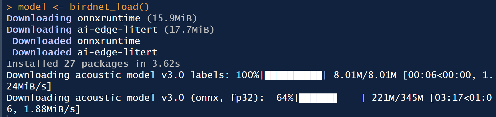
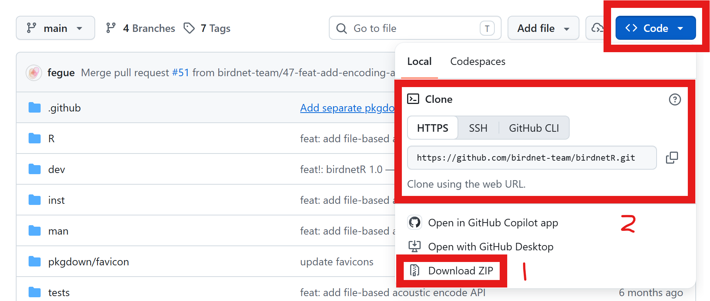

Hello! Welcome and thank you for your interest in the BirdNET workshop! This repository is the central hub for the BirdNET workshop.

-   **Audio data:** Bringing your own audio files is optional. All example recordings used in the workshop are provided in this repository.
-   **Need help?** If any of the installation steps below fail, or if you have any questions, please open an issue in this repo or send me an email at sunny\@sunnytseng.ca, and I'll help you sort it out.

## About

This workshop is part of the [International Ornithological Congress](https://iocongress2026.com/) 2026. It is free and open to all conference participants.

-   Instructor: [Sunny Tseng, PhD](https://sunnytseng.ca/)

-   Date / Time: **Nov. 30 2026** (Monday) **13:00 - 15:00** (local time)

-   Location: **Room 25A**, Yucatán International Congress Center, Merida

-   Workshop Slides: Coming soon (will be linked here before the workshop).

## What will be covered

BirdNET is one of the most widely used AI tools for identifying bird species from audio recordings. In this workshop, we will use two R packages built around BirdNET: `birdnetR`, the R interface for running BirdNET, and `birdnetTools`, which provides utilities for processing and validating BirdNET outputs. You will learn how to do the following in R:

-   Run single-file and batch audio analyses

-   Import detection tables and explore results (extract metadata, filter, and visualize detections)

-   Validate BirdNET detections

As a fun surprise, we will also play a BirdNET-powered game (still in R) to learn the birds of Mérida!

## Pre-workshop preparation

To make sure everyone gets the most out of the session, please complete the steps below **before** the workshop. They take less than 20 minutes in total.

### 1. Update R

Some of the packages we will use may not work with older versions of R. If your R version is older than 4.3.0, please update to the latest version. You can check your version by running `R.version.string` in the R console. To update, download the latest version from [CRAN](https://cran.r-project.org/).

### 2. Update RStudio / Positron (optional)

-   RStudio: Download the latest version from the [RStudio website](https://docs.posit.co/ide/user/download.html).
-   Positron: Download the latest version from the [Positron website](https://positron.posit.co/download.html).

### 3. Install the `birdnetR` package

Run one of the following in the R console:

1.  Install the released version from r-universe (recommended):

```r
install.packages('birdnetR', repos = c('https://birdnet-team.r-universe.dev', 'https://cloud.r-project.org'))
```

2.  Install the development version from GitHub:

``` r
# install.packages("pak")
pak::pak("birdnet-team/birdnetR")
```

Note that Python dependencies are installed on demand when you use them for the first time, which will make the initial setup take a little longer. To check that the installation worked, run:

``` r
library(birdnetR)

# Load the BirdNET+ V3.0 acoustic model (downloaded on first use)
model <- birdnet_load()
```

If you get no errors, you're all set. The model installation takes few minutes:



If the error message shows `function not found` try re-starting r session as installation might require restarting R session to work properly - `birdnetR` is having a breaking release on *Nov.26*, and we just happen to hit that transition!

### 4. Install the `birdnetTools` package

Run one of the following in the R console:

1.  Install the released version from r-universe (recommended):

``` r
install.packages('birdnetTools', repos = c('[https://sunnytseng.r-universe.dev](https://sunnytseng.r-universe.dev)', '[https://cloud.r-project.org](https://cloud.r-project.org)'))
```

2.  **Or** install the development version from GitHub:

``` r
# install.packages("pak")
pak::pak("birdnet-team/birdnetTools")
```

The installation should take no longer than 5 minutes. To check that the installation worked, run:

``` r
library(birdnetTools)
```

If you get no errors, you're all set.

### 5. Install other helper packages

``` r
install.packages(tidyverse)
install.packages(here)
```

### 6. Download this repo to your local computer

All the workshop materials, including slides and data, are in this repo. Download it using one of these methods:

1.  Download the `.zip` file

Click the blue **Code** button near the top right of this page, then click **Download ZIP**. After downloading, unzip the file to a location of your choice.

2.  Clone

If you already use Git / GitHub, click the blue **Code** button near the top right of this page, copy the HTTPS URL, and clone the repository.



## AI disclosure

The content of this workshop is based on the instructor's knowledge and experience. AI tools, specifically Claude, were used to edit and refine text, polish code, and troubleshoot errors in the code workflow.

<!-- ## Materials -->

<!-- -   [Slides](https://canva.link/20vf2q3n2kkflju): https://canva.link/20vf2q3n2kkflju\ -->

<!-- -   Practice dataset comes from a single AudioMoth deployed under a Great Cormorant colony of more than 3,000 breeding pairs in Curonian Spit National Park, in Lithuania. It includes one day of recordings, collected on 9 June 2025, with the recording schedule set to 1 minute on and 3 minutes off. This schedule yielded 360 one-minute recordings over the 24-hour period. -->

<!--     -   [Batch analysis](https://github.com/SunnyTseng/BirdNET-workshop/tree/master/data/batch%20analysis) -->

<!--     -   [Validation](https://github.com/SunnyTseng/BirdNET-workshop/tree/master/data/segment%20and%20review) -->

<!-- ## AI tools for bioacoustics -->

<!-- ### BirdNET -->

<!-- -   [Website](https://birdnet.cornell.edu/) -->

<!-- ### Perch -->

<!-- -   Github: https://github.com/google-research/perch -->

<!-- -   Publication: https://arxiv.org/html/2508.04665v2 -->

<!-- -   Youtube video for the publication:https://www.youtube.com/watch?v=Z_JmsEl0xbs -->

<!-- ### HawkEars -->

<!-- -   Github: https://github.com/jhuus/HawkEars -->

<!-- -   Publication: https://www.sciencedirect.com/science/article/pii/S1574954125001311 -->

<!-- ### OpenSoundscape -->

<!-- -   Website: https://opensoundscape.org/en/latest/ -->

<!-- ### SILIC -->

<!-- -   Github: https://github.com/RedbirdTaiwan/silic -->

<!-- -   Publicatnoi: https://www.sciencedirect.com/science/article/pii/S1574954121003253 -->

<!-- ### Others -->

<!-- -   Justin's talk in Wildlabs: https://www.youtube.com/watch?v=yFTHweoR-OU -->

<!-- -   2018 bioacoustics review paper: https://besjournals.onlinelibrary.wiley.com/doi/full/10.1111/2041-210X.13101 -->

<!-- -   2026 ARU + AI pipeline review paper: https://besjournals.onlinelibrary.wiley.com/doi/full/10.1111/2041-210x.70133 -->
