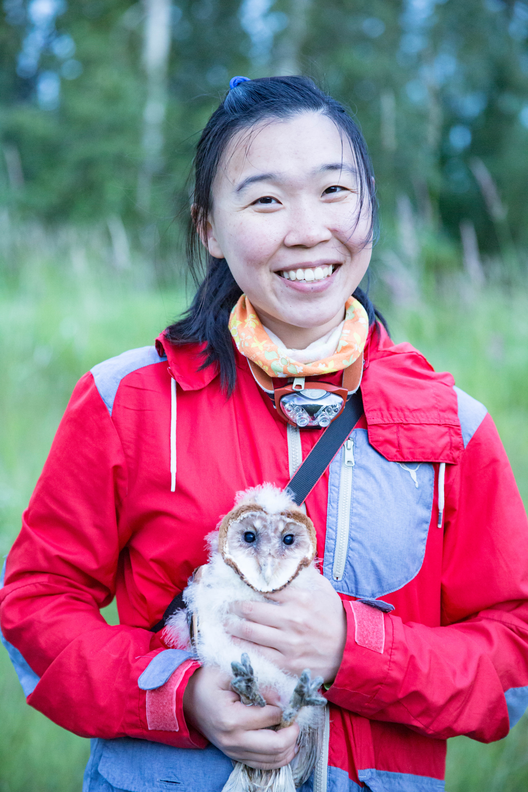
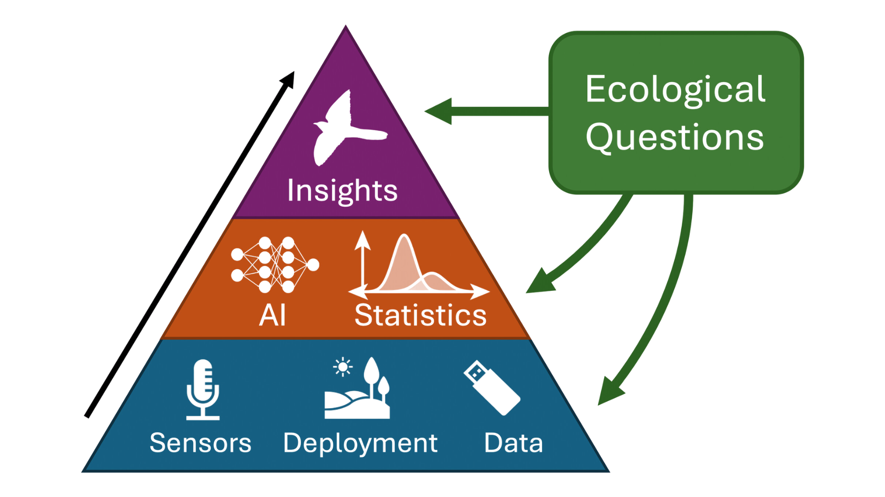
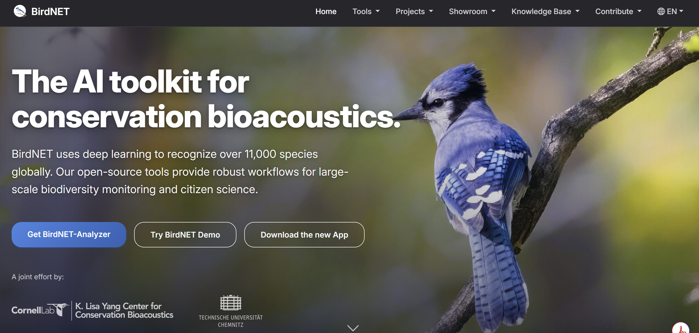
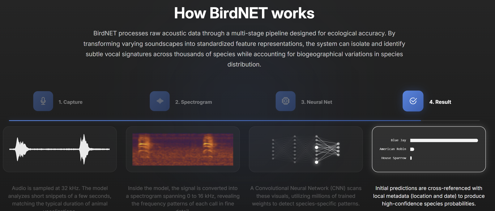
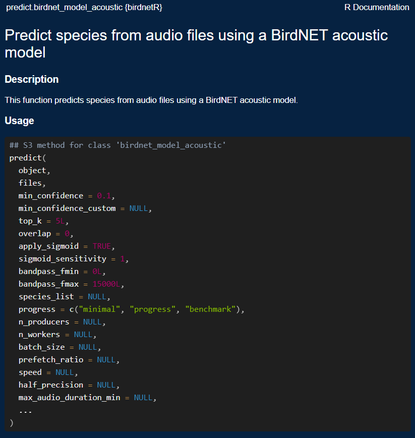
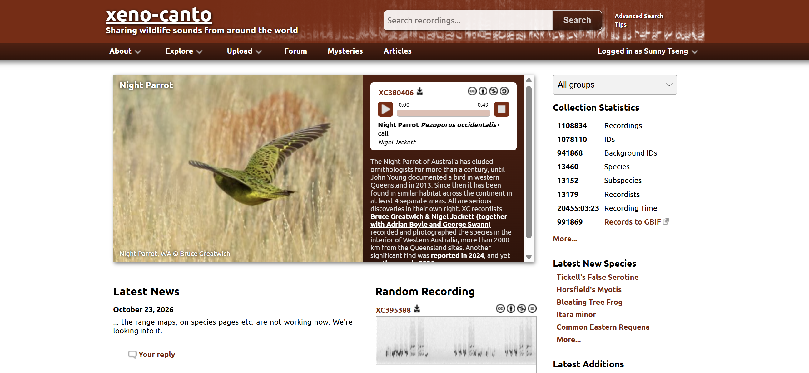
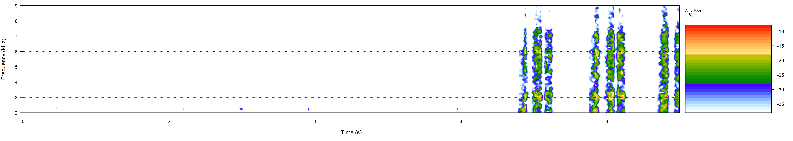
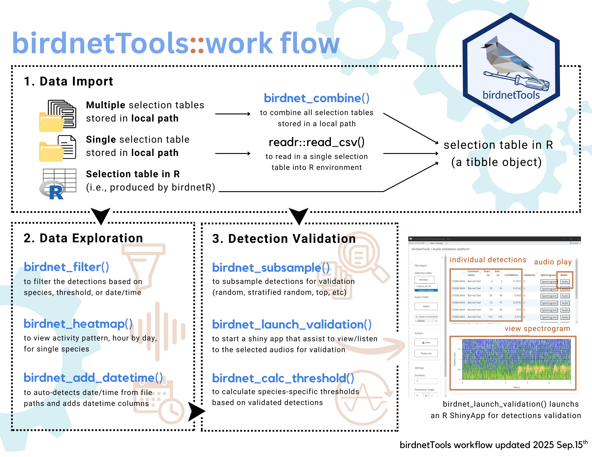

::: {.cell}

:::


## House keeping

-   WIFI: xyz (pwd: 12345678)

-   Workshop Github:

## About me

::::: columns
::: {.column width="65%"}
-   Independent data consultant

-   Developer of `birdnetTools` package

-   R user since 2015

    -   script --\> shinyR --\> rmarkdown --\> quarto --\> package development

    -   using AI agent in R

-   Sound recording

-   Hip hop dancing
:::

::: {.column width="35%"}

:::
:::::

## How about you

:::::: columns
:::: {.column width="35%"}
-   Your name

-   Experience with R

-   Spark bird

-   One thing want to do during IOC / in Merida?

::: fragment
> Nice to meet you all!
:::
::::

::: {.column width="65%"}

:::
::::::

::: aside
Artwork by [\@allison_horst](https://allisonhorst.com/), CC BY 4.0
:::

## Outline

1.  Analyzing audios with BirdNET in R (`birdnetR`, `birdnetTools`)
2.  Validating BirdNET detections in R (`birdnetTools`)
3.  Playing a game with BirdNET, in R!

. . .

> This workshop is meant to be a interactive session. So feel free to ask questions or share your experiences.

## Workshop rules

-   Your turn section
-   Stickers for practice time
-   Clone the repo for the code, slides, and dataset
- Open the R project
-   Data? Follow along? Breaks? Practice (blue and red tags)
- Copy code chunk instead of typing


# Analyze audio with BirdNET in R

## Bioacoustics workflow



::: aside
Figure adapted from [Kitzes et al., 2026](https://besjournals.onlinelibrary.wiley.com/doi/full/10.1111/2041-210x.70133), Methods in Ecology and Evolution
:::

## Global model - BirdNET

[BirdNET.cornell.edu](https://birdnet.cornell.edu/)



## What is BirdNET?

The AI toolkit for conservation bioacoustics

-   Developed by Cornell Lab of Ornithology **AND** Chemnitz University of Technology

-   Led by Stefan Kahl

-   First publication in 2021

-   CNN designed to classify sounds

-   Trained on [Macaulay library](https://www.macaulaylibrary.org/) and [Xeno-Canto](https://xeno-canto.org/)

-   Identifies 6,522 classes worldwide (model v2.4)

-   Open source on Github [BirdNET-Team](https://github.com/birdnet-team)


## How does BirdNET work?




## How does BirdNET work? (con'd)

A four-step architecture

1.  Capture
2.  Spectrogram
    -   It splits audio into 3-second segments

    -   Segments are converted into spectrograms (images)
3.  Neural Net
    -   Spectrograms are passed to CNN for image classification

    -   Detection of image patterns
4.  Result
    -   The output is a table, with **detected species** and **detection confidence**

    -   Geofencing output (species occurrence model based on eBird data)


## An example is worth a thousand words

::::: columns
::: {.column width="50%"}
**Input** - audio file


::: {.cell}

```{.r .cell-code}
# Load the package
library(birdnetR)

# Load the BirdNET model
model <- load_birdnet()

# Path to the audio file
audio_path <- here(
  "slides", 
  "birdnet_analysis_example", 
  "20250609_000000.wav"
  )

# Predict species within the audio file
predictions <- predict(model, audio_path)
```
:::


-   species detection + confidence
-   multi-species detections (3-6 sec)
:::

::: {.column width="50%"}
**Output** - detection table


::: {.cell}
::: {.cell-output-display}

```{=html}
<div class="datatables html-widget html-fill-item" id="htmlwidget-4d8c5cb2f8dcde4fcc66" style="width:100%;height:auto;"></div>
<script type="application/json" data-for="htmlwidget-4d8c5cb2f8dcde4fcc66">{"x":{"filter":"none","vertical":false,"data":[[0,3,3,6,9,15,33,36,51],[3,6,6,9,12,18,36,39,54],["Phalacrocorax carbo_Great Cormorant","Anthracoceros coronatus_Malabar Pied-Hornbill","Phalacrocorax carbo_Great Cormorant","Ficedula parva_Red-breasted Flycatcher","Phalacrocorax carbo_Great Cormorant","Hylocichla mustelina_Wood Thrush","Cyanocitta cristata_Blue Jay","Cardinalis cardinalis_Northern Cardinal","Phalacrocorax carbo_Great Cormorant"],[0.3532641530036926,0.2214092165231705,0.2141202092170715,0.1894774585962296,0.1872479766607285,0.1844827085733414,0.1145599707961082,0.1562230139970779,0.1154532805085182]],"container":"<table class=\"compact\">\n  <thead>\n    <tr>\n      <th>start_time<\/th>\n      <th>end_time<\/th>\n      <th>species_name<\/th>\n      <th>confidence<\/th>\n    <\/tr>\n  <\/thead>\n<\/table>","options":{"scrollX":true,"scrollY":"400px","paging":false,"dom":"ft","columnDefs":[{"className":"dt-right","targets":[0,1,3]},{"name":"start_time","targets":0},{"name":"end_time","targets":1},{"name":"species_name","targets":2},{"name":"confidence","targets":3}],"order":[],"autoWidth":false,"orderClasses":false}},"evals":[],"jsHooks":[]}</script>
```

:::
:::

:::
:::::

## Running BirdNET in R

The main package to run BirdNET in R is `birdnetR`. Load it with:


::: {.cell}

```{.r .cell-code}
library(birdnetR)
```
:::


Load the BirdNET model **once per R session** with `load_birdnet()`. The model files are downloaded in PC for first-time using (slow).


::: {.cell}

```{.r .cell-code}
model <- load_birdnet()
```
:::


A path to an audio file needs to be identified:


::: {.cell}

```{.r .cell-code}
audio_path <- here(
  "slides", 
  "birdnet_analysis_example", 
  "20250609_000000.wav"
  )
```
:::


Then we could make predictions with `predict()` function:


::: {.cell}

```{.r .cell-code}
predictions <- predict(model, audio_path)
```
:::


## Running BirdNET in R - output

The output is a list object in R, which can be viewed as a data frame:


::: {.cell}

```{.r .cell-code}
predictions |> as.data.frame()
```
:::


::: {.cell}
::: {.cell-output-display}

```{=html}
<div class="datatables html-widget html-fill-item" id="htmlwidget-d1c5b3528d260ed674f1" style="width:100%;height:auto;"></div>
<script type="application/json" data-for="htmlwidget-d1c5b3528d260ed674f1">{"x":{"filter":"none","vertical":false,"data":[[0,3,3,6,9,15,33,36,51],[3,6,6,9,12,18,36,39,54],["Phalacrocorax carbo_Great Cormorant","Anthracoceros coronatus_Malabar Pied-Hornbill","Phalacrocorax carbo_Great Cormorant","Ficedula parva_Red-breasted Flycatcher","Phalacrocorax carbo_Great Cormorant","Hylocichla mustelina_Wood Thrush","Cyanocitta cristata_Blue Jay","Cardinalis cardinalis_Northern Cardinal","Phalacrocorax carbo_Great Cormorant"],[0.3532641530036926,0.2214092165231705,0.2141202092170715,0.1894774585962296,0.1872479766607285,0.1844827085733414,0.1145599707961082,0.1562230139970779,0.1154532805085182]],"container":"<table class=\"compact\">\n  <thead>\n    <tr>\n      <th>start_time<\/th>\n      <th>end_time<\/th>\n      <th>species_name<\/th>\n      <th>confidence<\/th>\n    <\/tr>\n  <\/thead>\n<\/table>","options":{"scrollX":true,"scrollY":"300px","paging":false,"dom":"ft","columnDefs":[{"className":"dt-right","targets":[0,1,3]},{"name":"start_time","targets":0},{"name":"end_time","targets":1},{"name":"species_name","targets":2},{"name":"confidence","targets":3}],"order":[],"autoWidth":false,"orderClasses":false}},"evals":[],"jsHooks":[]}</script>
```

:::
:::


> "\|\>" is called "pipe", a way to pass the output of one function to the next function. See [Ch18-Pipes](https://r4ds.had.co.nz/pipes.html) in R for Data Science.


## `birdnetR::predict()` arguments

::: panel-tabset
## Default

::: {.cell}

```{.r .cell-code}
model <- load_birdnet()

audio_path <- here(
  "slides", 
  "birdnet_analysis_example", 
  "20250609_000000.wav"
  )

predictions <- predict(model, audio_path)
```
:::


::: {.cell}
::: {.cell-output-display}

```{=html}
<div class="datatables html-widget html-fill-item" id="htmlwidget-2045a202d6e7da945498" style="width:100%;height:auto;"></div>
<script type="application/json" data-for="htmlwidget-2045a202d6e7da945498">{"x":{"filter":"none","vertical":false,"data":[[0,3,3,6,9,15,33,36,51],[3,6,6,9,12,18,36,39,54],["Phalacrocorax carbo_Great Cormorant","Anthracoceros coronatus_Malabar Pied-Hornbill","Phalacrocorax carbo_Great Cormorant","Ficedula parva_Red-breasted Flycatcher","Phalacrocorax carbo_Great Cormorant","Hylocichla mustelina_Wood Thrush","Cyanocitta cristata_Blue Jay","Cardinalis cardinalis_Northern Cardinal","Phalacrocorax carbo_Great Cormorant"],[0.3532641530036926,0.2214092165231705,0.2141202092170715,0.1894774585962296,0.1872479766607285,0.1844827085733414,0.1145599707961082,0.1562230139970779,0.1154532805085182]],"container":"<table class=\"compact\">\n  <thead>\n    <tr>\n      <th>start_time<\/th>\n      <th>end_time<\/th>\n      <th>species_name<\/th>\n      <th>confidence<\/th>\n    <\/tr>\n  <\/thead>\n<\/table>","options":{"scrollX":true,"scrollY":"300px","paging":false,"dom":"ft","columnDefs":[{"className":"dt-right","targets":[0,1,3]},{"name":"start_time","targets":0},{"name":"end_time","targets":1},{"name":"species_name","targets":2},{"name":"confidence","targets":3}],"order":[],"autoWidth":false,"orderClasses":false}},"evals":[],"jsHooks":[]}</script>
```

:::
:::


## Confidence

::: {.cell}

```{.r .cell-code}
predictions <- predict(model, audio_path, min_confidence = 0.3)
```
:::


::: {.cell}
::: {.cell-output-display}

```{=html}
<div class="datatables html-widget html-fill-item" id="htmlwidget-8610b503bd09f1d41f3c" style="width:100%;height:auto;"></div>
<script type="application/json" data-for="htmlwidget-8610b503bd09f1d41f3c">{"x":{"filter":"none","vertical":false,"data":[[0],[3],["Phalacrocorax carbo_Great Cormorant"],[0.3532644510269165]],"container":"<table class=\"compact\">\n  <thead>\n    <tr>\n      <th>start_time<\/th>\n      <th>end_time<\/th>\n      <th>species_name<\/th>\n      <th>confidence<\/th>\n    <\/tr>\n  <\/thead>\n<\/table>","options":{"scrollX":true,"scrollY":"100px","paging":false,"dom":"ft","columnDefs":[{"className":"dt-right","targets":[0,1,3]},{"name":"start_time","targets":0},{"name":"end_time","targets":1},{"name":"species_name","targets":2},{"name":"confidence","targets":3}],"order":[],"autoWidth":false,"orderClasses":false}},"evals":[],"jsHooks":[]}</script>
```

:::
:::


- Default value of min_confidence is 0.1
- This is a universal minimum confidence, not species-specific


## Lat / Lon


::: {.cell}

```{.r .cell-code}
predictions <- predict(model, audio_path, latitude = 55.30, longitude = 20.99)
```
:::


::: {.cell}
::: {.cell-output-display}

```{=html}
<div class="datatables html-widget html-fill-item" id="htmlwidget-622f2a30ccea6830672a" style="width:100%;height:auto;"></div>
<script type="application/json" data-for="htmlwidget-622f2a30ccea6830672a">{"x":{"filter":"none","vertical":false,"data":[[0,3,3,6,9,15,33,36,51],[3,6,6,9,12,18,36,39,54],["Phalacrocorax carbo_Great Cormorant","Anthracoceros coronatus_Malabar Pied-Hornbill","Phalacrocorax carbo_Great Cormorant","Ficedula parva_Red-breasted Flycatcher","Phalacrocorax carbo_Great Cormorant","Hylocichla mustelina_Wood Thrush","Cyanocitta cristata_Blue Jay","Cardinalis cardinalis_Northern Cardinal","Phalacrocorax carbo_Great Cormorant"],[0.3532641530036926,0.2214092612266541,0.2141192406415939,0.1894775927066803,0.187248095870018,0.1844834983348846,0.1145599707961082,0.1562230139970779,0.1154531612992287]],"container":"<table class=\"compact\">\n  <thead>\n    <tr>\n      <th>start_time<\/th>\n      <th>end_time<\/th>\n      <th>species_name<\/th>\n      <th>confidence<\/th>\n    <\/tr>\n  <\/thead>\n<\/table>","options":{"scrollX":true,"scrollY":"300px","paging":false,"dom":"ft","columnDefs":[{"className":"dt-right","targets":[0,1,3]},{"name":"start_time","targets":0},{"name":"end_time","targets":1},{"name":"species_name","targets":2},{"name":"confidence","targets":3}],"order":[],"autoWidth":false,"orderClasses":false}},"evals":[],"jsHooks":[]}</script>
```

:::
:::


- Species list calculated by distribution model (eBird) for the given lat/lon

## Week


::: {.cell}

```{.r .cell-code}
predictions <- predict(model, audio_path, week = 22)
```
:::


::: {.cell}
::: {.cell-output-display}

```{=html}
<div class="datatables html-widget html-fill-item" id="htmlwidget-61bfd087e69d9ac9352f" style="width:100%;height:auto;"></div>
<script type="application/json" data-for="htmlwidget-61bfd087e69d9ac9352f">{"x":{"filter":"none","vertical":false,"data":[[0,3,3,6,9,15,33,36,51],[3,6,6,9,12,18,36,39,54],["Phalacrocorax carbo_Great Cormorant","Anthracoceros coronatus_Malabar Pied-Hornbill","Phalacrocorax carbo_Great Cormorant","Ficedula parva_Red-breasted Flycatcher","Phalacrocorax carbo_Great Cormorant","Hylocichla mustelina_Wood Thrush","Cyanocitta cristata_Blue Jay","Cardinalis cardinalis_Northern Cardinal","Phalacrocorax carbo_Great Cormorant"],[0.3532644510269165,0.2214092612266541,0.2141192406415939,0.1894775927066803,0.187248095870018,0.1844834983348846,0.11455999314785,0.1562230736017227,0.1154532805085182]],"container":"<table class=\"compact\">\n  <thead>\n    <tr>\n      <th>start_time<\/th>\n      <th>end_time<\/th>\n      <th>species_name<\/th>\n      <th>confidence<\/th>\n    <\/tr>\n  <\/thead>\n<\/table>","options":{"scrollX":true,"scrollY":"300px","paging":false,"dom":"ft","columnDefs":[{"className":"dt-right","targets":[0,1,3]},{"name":"start_time","targets":0},{"name":"end_time","targets":1},{"name":"species_name","targets":2},{"name":"confidence","targets":3}],"order":[],"autoWidth":false,"orderClasses":false}},"evals":[],"jsHooks":[]}</script>
```

:::
:::


- Week is defined by "four weeks per month" (1 ~ 48)
- For example, Mid June is week 22

## Species


::: {.cell}

```{.r .cell-code}
predictions <- predict(model, audio_path, species_list = "Phalacrocorax carbo_Great Cormorant")
```
:::


::: {.cell}
::: {.cell-output-display}

```{=html}
<div class="datatables html-widget html-fill-item" id="htmlwidget-63722c6b125b07b76ad0" style="width:100%;height:auto;"></div>
<script type="application/json" data-for="htmlwidget-63722c6b125b07b76ad0">{"x":{"filter":"none","vertical":false,"data":[[0,3,9,51],[3,6,12,54],["Phalacrocorax carbo_Great Cormorant","Phalacrocorax carbo_Great Cormorant","Phalacrocorax carbo_Great Cormorant","Phalacrocorax carbo_Great Cormorant"],[0.3532641530036926,0.2141202092170715,0.187248095870018,0.1154531612992287]],"container":"<table class=\"compact\">\n  <thead>\n    <tr>\n      <th>start_time<\/th>\n      <th>end_time<\/th>\n      <th>species_name<\/th>\n      <th>confidence<\/th>\n    <\/tr>\n  <\/thead>\n<\/table>","options":{"scrollX":true,"scrollY":"200px","paging":false,"dom":"ft","columnDefs":[{"className":"dt-right","targets":[0,1,3]},{"name":"start_time","targets":0},{"name":"end_time","targets":1},{"name":"species_name","targets":2},{"name":"confidence","targets":3}],"order":[],"autoWidth":false,"orderClasses":false}},"evals":[],"jsHooks":[]}</script>
```

:::
:::


- Useful when your target species is a single or only a few speicies

:::


## `birdnetR::predict()` arguments

::::: columns
::: {.column width="30%"}

::: {.cell}

```{.r .cell-code}
??birdnetR::predict
```
:::

:::

::: {.column width="70%"}

:::
:::::


## Your turn ⏱ 10 minutes

There is an audio in *slides* > *practice_single_analysis* > *example_audio_single_analysis.mp3*. 

- Which bird is the **dominant species** in this example recordings?
- **Challenge:** set the location to Mérida. Does it change the result?


### Hint


::: {.cell}

```{.r .cell-code}
library(birdnetR)
library(here)

model <- ___()

audio <- here("slides", "practice_single_analysis", "example_audio_single_analysis.mp3")

predictions <- predict(model, ___,
                       latitude = ___,  # Mérida: about 20.97
                       longitude = ___) # Mérida: about -89.61 (west is negative!)

predictions |> ___()
```
:::


## Your turn - solution

Northern Bobwhite (*Colinus_nigrogularis*)!


::: {.cell}
::: {.cell-output-display}

```{=html}
<div class="datatables html-widget html-fill-item" id="htmlwidget-ae890b5fa9c2eea9276d" style="width:100%;height:auto;"></div>
<script type="application/json" data-for="htmlwidget-ae890b5fa9c2eea9276d">{"x":{"filter":"none","vertical":false,"data":[[3,3,9,9,12,12,18,18,21,21,24,27,27,27,30,30,33,33,36,39,39,45,45,48,48,57,57,60,66,66,72,72,75,75,75,78,84,84,87,90,90,90,93,93,93,96,96,99,105,105,105,108,108,111,114,114,117,117,120,120,129,129,132,132,132,135,135,138,138],[6,6,12,12,15,15,21,21,24,24,27,30,30,30,33,33,36,36,39,42,42,48,48,51,51,60,60,63,69,69,75,75,78,78,78,81,87,87,90,93,93,93,96,96,96,99,99,102,108,108,108,111,111,114,117,117,120,120,123,123,132,132,135,135,135,138,138,141,141],["Colinus virginianus_Northern Bobwhite","Colinus nigrogularis_Black-throated Bobwhite","Vireo pallens_Mangrove Vireo","Colinus nigrogularis_Black-throated Bobwhite","Colinus nigrogularis_Black-throated Bobwhite","Colinus virginianus_Northern Bobwhite","Colinus nigrogularis_Black-throated Bobwhite","Vireo pallens_Mangrove Vireo","Colinus nigrogularis_Black-throated Bobwhite","Colinus virginianus_Northern Bobwhite","Dryobates minor_Lesser Spotted Woodpecker","Colinus nigrogularis_Black-throated Bobwhite","Colinus virginianus_Northern Bobwhite","Colinus cristatus_Crested Bobwhite","Colinus nigrogularis_Black-throated Bobwhite","Colinus virginianus_Northern Bobwhite","Vireo pallens_Mangrove Vireo","Colinus nigrogularis_Black-throated Bobwhite","Mimus gilvus_Tropical Mockingbird","Colinus virginianus_Northern Bobwhite","Colinus nigrogularis_Black-throated Bobwhite","Colinus nigrogularis_Black-throated Bobwhite","Icterus icterus_Venezuelan Troupial","Colinus nigrogularis_Black-throated Bobwhite","Colinus virginianus_Northern Bobwhite","Colinus virginianus_Northern Bobwhite","Colinus nigrogularis_Black-throated Bobwhite","Colinus nigrogularis_Black-throated Bobwhite","Colinus virginianus_Northern Bobwhite","Colinus nigrogularis_Black-throated Bobwhite","Eupsittula pertinax_Brown-throated Parakeet","Eupsittula cactorum_Cactus Parakeet","Colinus nigrogularis_Black-throated Bobwhite","Colinus virginianus_Northern Bobwhite","Colinus cristatus_Crested Bobwhite","Mimus gilvus_Tropical Mockingbird","Colinus nigrogularis_Black-throated Bobwhite","Colinus virginianus_Northern Bobwhite","Colinus nigrogularis_Black-throated Bobwhite","Sakesphorus canadensis_Black-crested Antshrike","Colinus nigrogularis_Black-throated Bobwhite","Cyclarhis gujanensis_Rufous-browed Peppershrike","Colinus nigrogularis_Black-throated Bobwhite","Vireo pallens_Mangrove Vireo","Icterus icterus_Venezuelan Troupial","Colinus nigrogularis_Black-throated Bobwhite","Colinus virginianus_Northern Bobwhite","Colinus nigrogularis_Black-throated Bobwhite","Colinus nigrogularis_Black-throated Bobwhite","Colinus virginianus_Northern Bobwhite","Vireo pallens_Mangrove Vireo","Colinus nigrogularis_Black-throated Bobwhite","Colinus virginianus_Northern Bobwhite","Colinus nigrogularis_Black-throated Bobwhite","Colinus nigrogularis_Black-throated Bobwhite","Mimus gilvus_Tropical Mockingbird","Colinus nigrogularis_Black-throated Bobwhite","Colinus virginianus_Northern Bobwhite","Vireo pallens_Mangrove Vireo","Colinus nigrogularis_Black-throated Bobwhite","Colinus nigrogularis_Black-throated Bobwhite","Colinus virginianus_Northern Bobwhite","Mimus gilvus_Tropical Mockingbird","Mimus polyglottos_Northern Mockingbird","Dryoscopus gambensis_Northern Puffback","Colinus nigrogularis_Black-throated Bobwhite","Mimus gilvus_Tropical Mockingbird","Mimus gilvus_Tropical Mockingbird","Mimus saturninus_Chalk-browed Mockingbird"],[0.9501569867134094,0.8163474798202515,0.7511604428291321,0.3233479857444763,0.9653602838516235,0.5733603835105896,0.3290477097034454,0.1851655244827271,0.8270338773727417,0.7650585174560547,0.1251253634691238,0.869525671005249,0.7042412757873535,0.1443713307380676,0.8634897470474243,0.7317355275154114,0.5419785380363464,0.2516826689243317,0.1608482599258423,0.8234364986419678,0.743336021900177,0.6009945869445801,0.1093026250600815,0.9629644751548767,0.9351901412010193,0.9270092844963074,0.8411473631858826,0.4387255907058716,0.8515858054161072,0.8319364190101624,0.2561871707439423,0.17475526034832,0.9945419430732727,0.5208397507667542,0.3922769725322723,0.2087514698505402,0.9117132425308228,0.668965220451355,0.1779452264308929,0.1494784355163574,0.1317995935678482,0.1144959479570389,0.9955726861953735,0.3960012793540955,0.1047467961907387,0.9688858389854431,0.9286042451858521,0.1026097163558006,0.9954586029052734,0.6161032915115356,0.4961938261985779,0.9597542285919189,0.5982808470726013,0.1277994811534882,0.1518501341342926,0.1087914183735847,0.9800374507904053,0.6754851341247559,0.4556576311588287,0.1136910542845726,0.9775623083114624,0.7197752594947815,0.2137377262115479,0.153249979019165,0.12009447067976,0.6520245671272278,0.1025122702121735,0.6330065727233887,0.1718911081552505]],"container":"<table class=\"compact\">\n  <thead>\n    <tr>\n      <th>start_time<\/th>\n      <th>end_time<\/th>\n      <th>species_name<\/th>\n      <th>confidence<\/th>\n    <\/tr>\n  <\/thead>\n<\/table>","options":{"scrollX":true,"scrollY":"150px","paging":false,"dom":"ft","columnDefs":[{"className":"dt-right","targets":[0,1,3]},{"name":"start_time","targets":0},{"name":"end_time","targets":1},{"name":"species_name","targets":2},{"name":"confidence","targets":3}],"order":[],"autoWidth":false,"orderClasses":false}},"evals":[],"jsHooks":[]}</script>
```

:::
:::


### Solution


::: {.cell}

```{.r .cell-code}
library(birdnetR)
library(here)

model <- load_birdnet()

audio <- here("slides", "practice_single_analysis", "example_audio_single_analysis.mp3")

predictions <- predict(model, audio,
                       latitude = 20.97, 
                       longitude = -89.61)

predictions |> as.data.frame()
```
:::


## A complete stack for research

BirdNET is not only a model, but a toolkit can be accessed by...

1.  **R packages**
2.  Online platform
3.  Raven Pro
4.  Phone apps
5.  GUI
6.  Python package


## Batch analysis

## Import BirdNET output into R

-   If birdnetR, then the output is in R already.
-   If other tools (e.g., GUI, Raven Pro), then need to import the output into R.


## Your turn - 2

# Validate BirdNET detections in R

## Your turn - 3

# Play a game with BirdNET, in R!

## Beat the BirdNET :bird:

A bird guessing game, designed with BirdNET

### How to play

1.  **Player A** picks a random recording
2.  **The Group** listens and guesses the species
3.  **BirdNET** reveals its guess
4.  We see who is right! :heart:

### How I made the game

**Step 1.** Explore / download Mérida birds on Xeno-Canto → `suwo`

**Step 2.** Read and check the audio in R → `tuneR`, `seewave`

**Step 3.** Identify species with BirdNET → `birdnetR`

## Step 1: Explore bird sounds

[Xeno-Canto](https://xeno-canto.org): \~1 million wildlife recordings, shared under CC licenses



## Query Merida recordings

Use the `query_xenocanto()` function from the `suwo` package:


::: {.cell}

```{.r .cell-code}
library(suwo)
```
:::


Merida area, songs, high quality recordings (109 recordings from 47 species):


::: {.cell}

```{.r .cell-code}
Merida_birds <- query_xenocanto(species = 'lat: "20.97" lon: "-89.61" type: "song" q:">C"')
```
:::


::: {.cell}
::: {.cell-output-display}

```{=html}
<div class="datatables html-widget html-fill-item" id="htmlwidget-0b84a74ca0eda6339634" style="width:100%;height:auto;"></div>
<script type="application/json" data-for="htmlwidget-0b84a74ca0eda6339634">{"x":{"filter":"none","vertical":false,"data":[[1,2,3,4,5,6,7,8,9,10,11,12,13,14,15,16,17,18,19,20,21,22,23,24,25,26,27,28,29,30,31,32,33,34,35,36,37,38,39,40,41,42,43,44,45,46,47,48,49,50,51,52,53,54,55,56,57,58,59,60,61,62,63,64,65,66,67,68,69,70,71,72,73,74,75,76,77,78,79,80,81,82,83,84,85,86,87,88,89,90,91,92,93,94,95,96,97,98,99,100,101,102,103,104,105,106,107,108,109],["872247","872246","987833","416874","416873","987830","872260","872258","872256","872254","1136176","1136447","356302","232544","657","872249","421931","872237","872236","417557","926812","987944","987943","595","987942","987941","596","441485","432157","987955","987954","987953","843028","987945","432162","987933","843027","964427","35871","987956","872278","872277","872274","872273","872272","872233","232194","356304","356303","964428","843029","843026","843024","583428","872251","514840","514839","843031","987836","987834","516004","385657","356301","35997","432160","432161","689978","224564","987934","987938","987937","797205","8856","685000","987940","35940","8851","8855","8854","8852","872227","872226","872225","872224","872223","872222","872221","987950","516175","391250","229696","615","614","613","872243","872242","872241","872240","872239","872238","797202","1136451","1136450","1136449","9341","8863","843181","843180","843179"],["Ortalis vetula","Ortalis vetula","Ortalis vetula","Colinus nigrogularis","Colinus nigrogularis","Colinus nigrogularis","Amazilia rutila","Amazilia rutila","Amazilia rutila","Amazilia rutila","Streptopelia decaocto","Zenaida asiatica","Zenaida asiatica","Zenaida asiatica","Egretta tricolor","Rupornis magnirostris","Geranoaetus albicaudatus","Glaucidium brasilianum","Glaucidium brasilianum","Bubo virginianus","Eumomota superciliosa","Melanerpes pygmaeus","Melanerpes pygmaeus","Melanerpes pygmaeus","Melanerpes aurifrons","Melanerpes aurifrons","Dryobates scalaris","Thamnophilus doliatus","Formicarius moniliger","Tyrannus couchii","Tyrannus couchii","Tyrannus couchii","Myiarchus yucatanensis","Myiarchus tyrannulus","Attila spadiceus","Cyclarhis gujanensis","Cyclarhis gujanensis","Cyclarhis gujanensis","Cyclarhis gujanensis","Vireo olivaceus","Vireo pallens","Vireo pallens","Vireo pallens","Vireo pallens","Vireo pallens","Vireo pallens","Vireo pallens","Vireo griseus","Vireo griseus","Campylorhynchus yucatanicus","Pheugopedius maculipectus","Pheugopedius maculipectus","Pheugopedius maculipectus","Pheugopedius maculipectus","Thryothorus ludovicianus","Troglodytes aedon","Troglodytes aedon","Uropsila leucogastra","Polioptila albiventris","Polioptila albiventris","Mimus gilvus","Mimus gilvus","Mimus gilvus","Turdus grayi","Euphonia affinis","Arremonops rufivirgatus","Arremonops rufivirgatus","Icterus chrysater","Icterus auratus","Icterus auratus","Icterus auratus","Icterus gularis","Icterus gularis","Icterus mesomelas","Icterus cucullatus","Dives dives","Dives dives","Dives dives","Dives dives","Dives dives","Quiscalus mexicanus","Quiscalus mexicanus","Quiscalus mexicanus","Quiscalus mexicanus","Quiscalus mexicanus","Quiscalus mexicanus","Quiscalus mexicanus","Quiscalus mexicanus","Setophaga petechia","Setophaga petechia","Setophaga petechia","Setophaga petechia","Setophaga petechia","Setophaga petechia","Granatellus sallaei","Granatellus sallaei","Granatellus sallaei","Granatellus sallaei","Granatellus sallaei","Granatellus sallaei","Cyanocompsa parellina","Saltator grandis","Saltator grandis","Saltator grandis","Saltator atriceps","Saltator atriceps","Mystery mystery","Mystery mystery","Mystery mystery"],["2024-01-31","2024-01-31","2025-04-10","2018-05-23","2018-05-23","2025-04-10","2024-01-21","2023-12-21","2024-01-21","2024-01-21","2026-05-20","2026-05-21","2017-02-17","1998-11-28","1999","2024-01-31","2018-06-20","2024-01-31","2024-01-31","2018-05-29","2024-08-10","2025-04-11","2025-04-11","1999","2025-04-11","2025-04-11","1999","2018-10-31","2018-08-25","2025-04-11","2025-04-11","2025-04-11","2023-06-25","2025-04-11","2018-08-25","2025-04-11","2023-06-25","2024-11-20","2009-06-08","2025-04-11","2024-01-21","2024-01-21","2024-01-21","2024-01-21","2024-01-21","2024-02-10","1998-11-28","2017-02-17","2017-02-17","2024-11-20","2023-06-25","2023-06-25","2023-06-25","2020-08-17","2024-01-31","2019-12-31","2019-12-31","2023-06-25","2025-04-10","2025-04-10","2018-02-09","2017-09-08","2017-02-16","2009-06-08","2018-08-25","2018-08-25","2017-02-13","1998-11-28","2025-04-11","2025-04-11","2025-04-11","2023-03-23","1990-10-15","2021-11-07","2025-04-11","2009-06-06","1990-10-15","1990-10-16","1990-10-16","1990-10-15","2024-02-02","2024-02-02","2024-02-10","2024-02-10","2024-02-10","2024-02-10","2024-02-02","2025-04-11","2019-12-31","2017-02-12","1998-11-29","1999","1999","1999","2024-01-31","2024-01-31","2024-01-31","2024-01-31","2024-01-31","2024-01-31","2023-03-23","2026-05-21","2026-05-21","2026-05-21","1990-10-16","1990-10-16","2023-07-04","2023-06-27","2023-06-27"],["09:00","08:30","08:00","07:00","07:00","08:00","08:30","08:30","08:30","08:00","07:07","06:39","07:30","07:00",null,"09:00","18:00","07:30","07:00","11:00","16:30","07:00","07:00",null,"07:00","07:00",null,"10:00","08:00","07:00","07:00","07:00","11:00","07:00","10:30","06:30","10:25","07:47","11:00","07:00","09:30","09:30","09:30","09:00","09:00","08:00","07:00","16:00","07:30","08:30","11:00","10:25","10:20","07:57","09:00","08:30","08:30","11:15","08:00","08:00","10:30","07:30","17:00","10:15","10:30","10:30","07:15","07:00","06:30","07:00","07:00","09:00",null,"08:30","07:00","11:00",null,null,null,null,"08:30","08:30","08:30","08:30","08:30","08:00","07:30","07:00","08:00","08:26","07:00",null,null,null,"08:30","08:30","08:30","08:30","07:30","07:30","08:00","06:12","06:10","06:20",null,null,"08:35","07:42","07:50"],["Alán Palacios","Alán Palacios","Gabriel Leite","Esau Toaki Villarreal","Esau Toaki Villarreal","Gabriel Leite","Alán Palacios","Alán Palacios","Alán Palacios","Alán Palacios","Manuel Grosselet","Manuel Grosselet","Manuel Grosselet","Peter Boesman","Dan Mennill","Alán Palacios","Esau Toaki Villarreal","Alán Palacios","Alán Palacios","Esau Toaki Villarreal","Karen Valladares","Gabriel Leite","Gabriel Leite","Dan Mennill","Gabriel Leite","Gabriel Leite","Dan Mennill","Esau Toaki Villarreal","Manuel Grosselet","Gabriel Leite","Gabriel Leite","Gabriel Leite","Matthew L. Brady","Gabriel Leite","Manuel Grosselet","Gabriel Leite","Matthew L. Brady","Bill Pyle","Stuart Fisher","Gabriel Leite","Alán Palacios","Alán Palacios","Alán Palacios","Alán Palacios","Alán Palacios","Alán Palacios","Peter Boesman","Manuel Grosselet","Manuel Grosselet","Bill Pyle","Matthew L. Brady","Matthew L. Brady","Matthew L. Brady","Alfredo Dorantes Euan","Alán Palacios","Esau Toaki Villarreal","Esau Toaki Villarreal","Matthew L. Brady","Gabriel Leite","Gabriel Leite","Esau Toaki Villarreal","Esau Toaki Villarreal","Manuel Grosselet","Stuart Fisher","Manuel Grosselet","Manuel Grosselet","Ron A. Fernandez-Gómez","Peter Boesman","Gabriel Leite","Gabriel Leite","Gabriel Leite","Bobby Wilcox","Allen T. Chartier","Esau Toaki Villarreal","Gabriel Leite","Stuart Fisher","Allen T. Chartier","Allen T. Chartier","Allen T. Chartier","Allen T. Chartier","Alán Palacios","Alán Palacios","Alán Palacios","Alán Palacios","Alán Palacios","Alán Palacios","Alán Palacios","Gabriel Leite","Esau Toaki Villarreal","Ron A. Fernandez","Peter Boesman","Dan Mennill","Dan Mennill","Dan Mennill","Alán Palacios","Alán Palacios","Alán Palacios","Alán Palacios","Alán Palacios","Alán Palacios","Bobby Wilcox","Manuel Grosselet","Manuel Grosselet","Manuel Grosselet","Allen T. Chartier","Allen T. Chartier","Matthew L. Brady","Matthew L. Brady","Matthew L. Brady"],["Localidad Camino San Antonio Chel - San Miguel Chac","Localidad Camino San Antonio Chel - San Miguel Chac","Cerrito, Dzilam González Municipality, Yucatán","Sisal, Hunucmá, Yucatán","Sisal, Hunucmá, Yucatán","Cerrito, Dzilam González Municipality, Yucatán","Localidad Sendero Manglar al Este de Sisal","Localidad Sendero Manglar al Este de Sisal","Localidad Sendero Manglar al Este de Sisal","Localidad Sendero Manglar al Este de Sisal","Mérida, Mérida Municipality, Yucatán","Mérida, Mérida Municipality, Yucatán","Mérida, Merida, Yucatán","Uxmal Ruins, Yucatan, Yucatan","Celestun, Yucatan","Localidad Camino San Antonio Chel - San Miguel Chac","Hunucmá, Yucatán","Localidad Camino San Antonio Chel - San Miguel Chac","Localidad Camino San Antonio Chel - San Miguel Chac","Sisal, Hunucmá, Yucatán","Noc Ac, Mérida Municipality, Yucatán","Mérida, Merida, Yucatán","Mérida, Merida, Yucatán","Celestun, Yucatan","Mérida, Merida, Yucatán","Mérida, Merida, Yucatán","Celestun, Yucatan","Hunucmá, Yucatán","Tenabo Municipality, Campeche","Mérida, Merida, Yucatán","Mérida, Merida, Yucatán","Mérida, Merida, Yucatán","~4 km SSW Santa Elena, Santa Elena Municipality, Yucatán","Mérida, Merida, Yucatán","Tenabo Municipality, Campeche","Mérida, Merida, Yucatán","~4 km SSW Santa Elena, Santa Elena Municipality, Yucatán","Reserva de la Biosfera Ría Celestún--Carretera 12, Celestún, Yucatán","Yucatan, Uxmal Ruins ","Mérida, Merida, Yucatán","Localidad Sendero Manglar al Este de Sisal","Localidad Sendero Manglar al Este de Sisal","Localidad Sendero Manglar al Este de Sisal","Localidad Sendero Manglar al Este de Sisal","Localidad Sendero Manglar al Este de Sisal","Localidad Reserva Estatal El Palmar--Santuario de los Flamencos","Uxmal Ruins, Yucatan, Yucatan","Mérida, Merida, Yucatán","Mérida, Merida, Yucatán","Reserva de la Biosfera Ría Celestún--Carretera 12, Celestún, Yucatán","~4 km SSW Santa Elena, Santa Elena Municipality, Yucatán","~4 km SSW Santa Elena, Santa Elena Municipality, Yucatán","~4 km SSW Santa Elena, Santa Elena Municipality, Yucatán","Las Américas VI, Mérida Municipality, Yucatán","Localidad Camino San Antonio Chel - San Miguel Chac","Sisal, Hunucmá, Yucatán","Sisal, Hunucmá, Yucatán","~4 km SSW Santa Elena, Santa Elena Municipality, Yucatán","Cerrito, Dzilam González Municipality, Yucatán","Cerrito, Dzilam González Municipality, Yucatán","Sisal, Hunucmá, Yucatán","Sisal, Hunucmá, Yucatán","Mérida, Merida, Yucatán","Yucatan, Uxmal Ruins ","Tenabo Municipality, Campeche","Tenabo Municipality, Campeche","Mérida, Mérida Municipality, Yucatán","Uxmal Ruins, Yucatan, Yucatan","Mérida, Merida, Yucatán","Mérida, Merida, Yucatán","Mérida, Merida, Yucatán","Misnébalam, Mérida Municipality, Yucatan","Yucatan, Uxmal Ruins","Sisal, Hunucmá, Yucatán","Mérida, Merida, Yucatán","Yucatan, Uxmal Ruins ","Yucatan, Uxmal Ruins","Yucatan, Uxmal Ruins","Yucatan, Uxmal Ruins","Yucatan, Uxmal Ruins","Localidad Reserva Estatal El Palmar--Santuario de los Flamencos","Localidad Reserva Estatal El Palmar--Santuario de los Flamencos","Localidad Reserva Estatal El Palmar--Santuario de los Flamencos","Localidad Reserva Estatal El Palmar--Santuario de los Flamencos","Localidad Reserva Estatal El Palmar--Santuario de los Flamencos","Localidad Reserva Estatal El Palmar--Santuario de los Flamencos","Localidad Reserva Estatal El Palmar--Santuario de los Flamencos","Mérida, Merida, Yucatán","Sisal, Hunucmá, Yucatán","Celestún, Celestún, Yucatán","Celestun, Yucatan","Celestun, Yucatan","Celestun, Yucatan","Celestun, Yucatan","Localidad Camino San Antonio Chel - San Miguel Chac","Localidad Camino San Antonio Chel - San Miguel Chac","Localidad Camino San Antonio Chel - San Miguel Chac","Localidad Camino San Antonio Chel - San Miguel Chac","Localidad Camino San Antonio Chel - San Miguel Chac","Localidad Camino San Antonio Chel - San Miguel Chac","Uxmal, Santa Elena Municipality, Yucatan","Mérida, Mérida Municipality, Yucatán","Mérida, Mérida Municipality, Yucatán","Mérida, Mérida Municipality, Yucatán","Yucatan, Uxmal Ruins","Yucatan, Uxmal Ruins","~7 km SW Ticul, Ticul Municipality, Yucatan","~4 km SSW Santa Elena, Santa Elena Municipality, Yucatán","~4 km SSW Santa Elena, Santa Elena Municipality, Yucatán"],["wav","wav","wav","mp3","mp3","wav","wav","wav","wav","wav","wav","wav","mp3","mp3","mp3","wav","mp3","wav","wav","mp3","mp3","wav","wav","mp3","wav","wav","mp3","mp3","mp3","wav","wav","wav","wav","wav","mp3","wav","wav","wav","mp3","wav","wav","wav","wav","wav","wav","wav","mp3","mp3","mp3","wav","wav","wav","wav","mp3","wav","mp3","mp3","wav","wav","wav","mp3","mp3","mp3","mp3","mp3","mp3","mp3","mp3","wav","wav","wav","mp3","mp3","mp3","wav","mp3","mp3","mp3","mp3","mp3","wav","wav","wav","wav","wav","wav","wav","wav","mp3","mp3","mp3","mp3","mp3","mp3","wav","wav","wav","wav","wav","wav","mp3","wav","wav","wav","mp3","mp3","wav","wav","wav"]],"container":"<table class=\"compact\">\n  <thead>\n    <tr>\n      <th>number<\/th>\n      <th>key<\/th>\n      <th>species<\/th>\n      <th>date<\/th>\n      <th>time<\/th>\n      <th>user_name<\/th>\n      <th>locality<\/th>\n      <th>file_extension<\/th>\n    <\/tr>\n  <\/thead>\n<\/table>","options":{"scrollX":true,"scrollY":"400px","paging":false,"dom":"ft","columnDefs":[{"className":"dt-right","targets":0},{"name":"number","targets":0},{"name":"key","targets":1},{"name":"species","targets":2},{"name":"date","targets":3},{"name":"time","targets":4},{"name":"user_name","targets":5},{"name":"locality","targets":6},{"name":"file_extension","targets":7}],"order":[],"autoWidth":false,"orderClasses":false}},"evals":[],"jsHooks":[]}</script>
```

:::
:::


## Download and read into R

Use the `download_media()` function from the `suwo` package:

Batch download:


::: {.cell}

:::


::: {.cell}

```{.r .cell-code}
download_media(metadata = Merida_birds |> head(6),
               path = audio_dir)
```

::: {.cell-output .cell-output-stdout}

```
Downloading media files:
```


:::

::: {.cell-output .cell-output-stderr}

```
✔ All files were already there (overwritten = FALSE) 🎉
```


:::
:::


## Step 2: Read and check audio in R

Use the `readWave()` or `readMP3()` function from the `tuneR` package:


::: {.cell}

```{.r .cell-code}
library(tuneR)
```
:::


Let's read one audio in the `audio_dir` folder:


::: {.cell}

```{.r .cell-code}
audio_path <- tibble(path = list.files(audio_dir, pattern = "\\.(mp3|wav)$",
                                 full.names = TRUE, ignore.case = TRUE)) |>
  mutate(modified = file.mtime(path)) |>
  slice_min(modified, n = 1) |> 
  pull(path)

audio_path
```

::: {.cell-output .cell-output-stdout}

```
[1] "C:/Users/sunny/Dropbox/work_remotely/BirdNET-workshop/slides/audio/Ortalis_vetula-XC872247.wav"
```


:::
:::


Check the file extension and read it accordingly:


::: {.cell}

```{.r .cell-code}
ext <- tolower(tools::file_ext(audio_path))

if (ext == "mp3") {
  audio <- readMP3(audio_path)
} else if (ext == "wav") {
  audio <- readWave(audio_path)
}
```
:::


## Listen

To listen, use the `play()` function from the `tuneR` package:


::: {.cell}

```{.r .cell-code}
library(tuneR)
```
:::


Indicate the audio object:


::: {.cell}

```{.r .cell-code}
audio |> 
  play()
```
:::


::: {.cell}
::: {.cell-output-display}

```{=html}
<audio src="audio/Ortalis_vetula-XC872247.wav" controls="controls"></audio>
```

:::
:::


## Look

To visualize, use the `spectro()` function from the `seewave` package:


::: {.cell}

```{.r .cell-code}
library(seewave)
```
:::


Indicate the audio abject:


::: {.cell}

```{.r .cell-code}
audio |>
  extractWave(from = 2, to = 11, xunit = "time") |>
  spectro(flim = c(2, 9),
          fastdisp = TRUE)
```

::: {.cell-output-display}
{width=100%}
:::
:::


-   **x-axis**: time, **y-axis**: pitch, **darkness**: loudness
-   Every species has a "shape" you can learn to read

## Step 3: What does the BirdNET say?

Use the `predict()` function from the `birdnetR` package.


::: {.cell}

```{.r .cell-code}
library(birdnetR)
```
:::


Load model and run prediction:


::: {.cell}

```{.r .cell-code}
model <- load_birdnet()

predictions <- predict(model,
                       files = audio_path,
                       min_confidence = 0.3)
```
:::


::: {.cell}
::: {.cell-output-display}

```{=html}
<div class="datatables html-widget html-fill-item" id="htmlwidget-b46911d72f714ffadd63" style="width:100%;height:auto;"></div>
<script type="application/json" data-for="htmlwidget-b46911d72f714ffadd63">{"x":{"filter":"none","vertical":false,"data":[[0,3,6,9,12,15],[3,6,9,12,15,18],["Ortalis vetula_Plain Chachalaca","Ortalis vetula_Plain Chachalaca","Ortalis vetula_Plain Chachalaca","Ortalis vetula_Plain Chachalaca","Ortalis vetula_Plain Chachalaca","Ortalis vetula_Plain Chachalaca"],[0.5626555681228638,0.9881404638290405,0.995261013507843,0.9998801946640015,0.9998267292976379,0.999972939491272]],"container":"<table class=\"compact\">\n  <thead>\n    <tr>\n      <th>start_time<\/th>\n      <th>end_time<\/th>\n      <th>species_name<\/th>\n      <th>confidence<\/th>\n    <\/tr>\n  <\/thead>\n<\/table>","options":{"scrollX":true,"scrollY":"400px","paging":false,"dom":"ft","columnDefs":[{"className":"dt-right","targets":[0,1,3]},{"name":"start_time","targets":0},{"name":"end_time","targets":1},{"name":"species_name","targets":2},{"name":"confidence","targets":3}],"order":[],"autoWidth":false,"orderClasses":false}},"evals":[],"jsHooks":[]}</script>
```

:::
:::


## Put everything together

### How to play

1.  **Player A** picks a random recording
2.  **The Group** listens and guesses the species
3.  **BirdNET** reveals its guess
4.  We see who is right! :heart:

> Ready to "Beat the BirdNET"? :video_game:

## Final peek for our answer sheet

A total of 109 recordings from 47 species


::: {.cell}
::: {.cell-output-display}

```{=html}
<div class="datatables html-widget html-fill-item" id="htmlwidget-c66a444718f695b07073" style="width:100%;height:auto;"></div>
<script type="application/json" data-for="htmlwidget-c66a444718f695b07073">{"x":{"filter":"none","vertical":false,"data":[[1,2,3,4,5,6,7,8,9,10,11,12,13,14,15,16,17,18,19,20,21,22,23,24,25,26,27,28,29,30,31,32,33,34,35,36,37,38,39,40,41,42,43,44,45,46,47,48,49,50,51,52,53,54,55,56,57,58,59,60,61,62,63,64,65,66,67,68,69,70,71,72,73,74,75,76,77,78,79,80,81,82,83,84,85,86,87,88,89,90,91,92,93,94,95,96,97,98,99,100,101,102,103,104,105,106,107,108,109],["872247","872246","987833","416874","416873","987830","872260","872258","872256","872254","1136176","1136447","356302","232544","657","872249","421931","872237","872236","417557","926812","987944","987943","595","987942","987941","596","441485","432157","987955","987954","987953","843028","987945","432162","987933","843027","964427","35871","987956","872278","872277","872274","872273","872272","872233","232194","356304","356303","964428","843029","843026","843024","583428","872251","514840","514839","843031","987836","987834","516004","385657","356301","35997","432160","432161","689978","224564","987934","987938","987937","797205","8856","685000","987940","35940","8851","8855","8854","8852","872227","872226","872225","872224","872223","872222","872221","987950","516175","391250","229696","615","614","613","872243","872242","872241","872240","872239","872238","797202","1136451","1136450","1136449","9341","8863","843181","843180","843179"],["Ortalis vetula","Ortalis vetula","Ortalis vetula","Colinus nigrogularis","Colinus nigrogularis","Colinus nigrogularis","Amazilia rutila","Amazilia rutila","Amazilia rutila","Amazilia rutila","Streptopelia decaocto","Zenaida asiatica","Zenaida asiatica","Zenaida asiatica","Egretta tricolor","Rupornis magnirostris","Geranoaetus albicaudatus","Glaucidium brasilianum","Glaucidium brasilianum","Bubo virginianus","Eumomota superciliosa","Melanerpes pygmaeus","Melanerpes pygmaeus","Melanerpes pygmaeus","Melanerpes aurifrons","Melanerpes aurifrons","Dryobates scalaris","Thamnophilus doliatus","Formicarius moniliger","Tyrannus couchii","Tyrannus couchii","Tyrannus couchii","Myiarchus yucatanensis","Myiarchus tyrannulus","Attila spadiceus","Cyclarhis gujanensis","Cyclarhis gujanensis","Cyclarhis gujanensis","Cyclarhis gujanensis","Vireo olivaceus","Vireo pallens","Vireo pallens","Vireo pallens","Vireo pallens","Vireo pallens","Vireo pallens","Vireo pallens","Vireo griseus","Vireo griseus","Campylorhynchus yucatanicus","Pheugopedius maculipectus","Pheugopedius maculipectus","Pheugopedius maculipectus","Pheugopedius maculipectus","Thryothorus ludovicianus","Troglodytes aedon","Troglodytes aedon","Uropsila leucogastra","Polioptila albiventris","Polioptila albiventris","Mimus gilvus","Mimus gilvus","Mimus gilvus","Turdus grayi","Euphonia affinis","Arremonops rufivirgatus","Arremonops rufivirgatus","Icterus chrysater","Icterus auratus","Icterus auratus","Icterus auratus","Icterus gularis","Icterus gularis","Icterus mesomelas","Icterus cucullatus","Dives dives","Dives dives","Dives dives","Dives dives","Dives dives","Quiscalus mexicanus","Quiscalus mexicanus","Quiscalus mexicanus","Quiscalus mexicanus","Quiscalus mexicanus","Quiscalus mexicanus","Quiscalus mexicanus","Quiscalus mexicanus","Setophaga petechia","Setophaga petechia","Setophaga petechia","Setophaga petechia","Setophaga petechia","Setophaga petechia","Granatellus sallaei","Granatellus sallaei","Granatellus sallaei","Granatellus sallaei","Granatellus sallaei","Granatellus sallaei","Cyanocompsa parellina","Saltator grandis","Saltator grandis","Saltator grandis","Saltator atriceps","Saltator atriceps","Mystery mystery","Mystery mystery","Mystery mystery"],["2024-01-31","2024-01-31","2025-04-10","2018-05-23","2018-05-23","2025-04-10","2024-01-21","2023-12-21","2024-01-21","2024-01-21","2026-05-20","2026-05-21","2017-02-17","1998-11-28","1999","2024-01-31","2018-06-20","2024-01-31","2024-01-31","2018-05-29","2024-08-10","2025-04-11","2025-04-11","1999","2025-04-11","2025-04-11","1999","2018-10-31","2018-08-25","2025-04-11","2025-04-11","2025-04-11","2023-06-25","2025-04-11","2018-08-25","2025-04-11","2023-06-25","2024-11-20","2009-06-08","2025-04-11","2024-01-21","2024-01-21","2024-01-21","2024-01-21","2024-01-21","2024-02-10","1998-11-28","2017-02-17","2017-02-17","2024-11-20","2023-06-25","2023-06-25","2023-06-25","2020-08-17","2024-01-31","2019-12-31","2019-12-31","2023-06-25","2025-04-10","2025-04-10","2018-02-09","2017-09-08","2017-02-16","2009-06-08","2018-08-25","2018-08-25","2017-02-13","1998-11-28","2025-04-11","2025-04-11","2025-04-11","2023-03-23","1990-10-15","2021-11-07","2025-04-11","2009-06-06","1990-10-15","1990-10-16","1990-10-16","1990-10-15","2024-02-02","2024-02-02","2024-02-10","2024-02-10","2024-02-10","2024-02-10","2024-02-02","2025-04-11","2019-12-31","2017-02-12","1998-11-29","1999","1999","1999","2024-01-31","2024-01-31","2024-01-31","2024-01-31","2024-01-31","2024-01-31","2023-03-23","2026-05-21","2026-05-21","2026-05-21","1990-10-16","1990-10-16","2023-07-04","2023-06-27","2023-06-27"],["09:00","08:30","08:00","07:00","07:00","08:00","08:30","08:30","08:30","08:00","07:07","06:39","07:30","07:00",null,"09:00","18:00","07:30","07:00","11:00","16:30","07:00","07:00",null,"07:00","07:00",null,"10:00","08:00","07:00","07:00","07:00","11:00","07:00","10:30","06:30","10:25","07:47","11:00","07:00","09:30","09:30","09:30","09:00","09:00","08:00","07:00","16:00","07:30","08:30","11:00","10:25","10:20","07:57","09:00","08:30","08:30","11:15","08:00","08:00","10:30","07:30","17:00","10:15","10:30","10:30","07:15","07:00","06:30","07:00","07:00","09:00",null,"08:30","07:00","11:00",null,null,null,null,"08:30","08:30","08:30","08:30","08:30","08:00","07:30","07:00","08:00","08:26","07:00",null,null,null,"08:30","08:30","08:30","08:30","07:30","07:30","08:00","06:12","06:10","06:20",null,null,"08:35","07:42","07:50"],["Alán Palacios","Alán Palacios","Gabriel Leite","Esau Toaki Villarreal","Esau Toaki Villarreal","Gabriel Leite","Alán Palacios","Alán Palacios","Alán Palacios","Alán Palacios","Manuel Grosselet","Manuel Grosselet","Manuel Grosselet","Peter Boesman","Dan Mennill","Alán Palacios","Esau Toaki Villarreal","Alán Palacios","Alán Palacios","Esau Toaki Villarreal","Karen Valladares","Gabriel Leite","Gabriel Leite","Dan Mennill","Gabriel Leite","Gabriel Leite","Dan Mennill","Esau Toaki Villarreal","Manuel Grosselet","Gabriel Leite","Gabriel Leite","Gabriel Leite","Matthew L. Brady","Gabriel Leite","Manuel Grosselet","Gabriel Leite","Matthew L. Brady","Bill Pyle","Stuart Fisher","Gabriel Leite","Alán Palacios","Alán Palacios","Alán Palacios","Alán Palacios","Alán Palacios","Alán Palacios","Peter Boesman","Manuel Grosselet","Manuel Grosselet","Bill Pyle","Matthew L. Brady","Matthew L. Brady","Matthew L. Brady","Alfredo Dorantes Euan","Alán Palacios","Esau Toaki Villarreal","Esau Toaki Villarreal","Matthew L. Brady","Gabriel Leite","Gabriel Leite","Esau Toaki Villarreal","Esau Toaki Villarreal","Manuel Grosselet","Stuart Fisher","Manuel Grosselet","Manuel Grosselet","Ron A. Fernandez-Gómez","Peter Boesman","Gabriel Leite","Gabriel Leite","Gabriel Leite","Bobby Wilcox","Allen T. Chartier","Esau Toaki Villarreal","Gabriel Leite","Stuart Fisher","Allen T. Chartier","Allen T. Chartier","Allen T. Chartier","Allen T. Chartier","Alán Palacios","Alán Palacios","Alán Palacios","Alán Palacios","Alán Palacios","Alán Palacios","Alán Palacios","Gabriel Leite","Esau Toaki Villarreal","Ron A. Fernandez","Peter Boesman","Dan Mennill","Dan Mennill","Dan Mennill","Alán Palacios","Alán Palacios","Alán Palacios","Alán Palacios","Alán Palacios","Alán Palacios","Bobby Wilcox","Manuel Grosselet","Manuel Grosselet","Manuel Grosselet","Allen T. Chartier","Allen T. Chartier","Matthew L. Brady","Matthew L. Brady","Matthew L. Brady"],["Localidad Camino San Antonio Chel - San Miguel Chac","Localidad Camino San Antonio Chel - San Miguel Chac","Cerrito, Dzilam González Municipality, Yucatán","Sisal, Hunucmá, Yucatán","Sisal, Hunucmá, Yucatán","Cerrito, Dzilam González Municipality, Yucatán","Localidad Sendero Manglar al Este de Sisal","Localidad Sendero Manglar al Este de Sisal","Localidad Sendero Manglar al Este de Sisal","Localidad Sendero Manglar al Este de Sisal","Mérida, Mérida Municipality, Yucatán","Mérida, Mérida Municipality, Yucatán","Mérida, Merida, Yucatán","Uxmal Ruins, Yucatan, Yucatan","Celestun, Yucatan","Localidad Camino San Antonio Chel - San Miguel Chac","Hunucmá, Yucatán","Localidad Camino San Antonio Chel - San Miguel Chac","Localidad Camino San Antonio Chel - San Miguel Chac","Sisal, Hunucmá, Yucatán","Noc Ac, Mérida Municipality, Yucatán","Mérida, Merida, Yucatán","Mérida, Merida, Yucatán","Celestun, Yucatan","Mérida, Merida, Yucatán","Mérida, Merida, Yucatán","Celestun, Yucatan","Hunucmá, Yucatán","Tenabo Municipality, Campeche","Mérida, Merida, Yucatán","Mérida, Merida, Yucatán","Mérida, Merida, Yucatán","~4 km SSW Santa Elena, Santa Elena Municipality, Yucatán","Mérida, Merida, Yucatán","Tenabo Municipality, Campeche","Mérida, Merida, Yucatán","~4 km SSW Santa Elena, Santa Elena Municipality, Yucatán","Reserva de la Biosfera Ría Celestún--Carretera 12, Celestún, Yucatán","Yucatan, Uxmal Ruins ","Mérida, Merida, Yucatán","Localidad Sendero Manglar al Este de Sisal","Localidad Sendero Manglar al Este de Sisal","Localidad Sendero Manglar al Este de Sisal","Localidad Sendero Manglar al Este de Sisal","Localidad Sendero Manglar al Este de Sisal","Localidad Reserva Estatal El Palmar--Santuario de los Flamencos","Uxmal Ruins, Yucatan, Yucatan","Mérida, Merida, Yucatán","Mérida, Merida, Yucatán","Reserva de la Biosfera Ría Celestún--Carretera 12, Celestún, Yucatán","~4 km SSW Santa Elena, Santa Elena Municipality, Yucatán","~4 km SSW Santa Elena, Santa Elena Municipality, Yucatán","~4 km SSW Santa Elena, Santa Elena Municipality, Yucatán","Las Américas VI, Mérida Municipality, Yucatán","Localidad Camino San Antonio Chel - San Miguel Chac","Sisal, Hunucmá, Yucatán","Sisal, Hunucmá, Yucatán","~4 km SSW Santa Elena, Santa Elena Municipality, Yucatán","Cerrito, Dzilam González Municipality, Yucatán","Cerrito, Dzilam González Municipality, Yucatán","Sisal, Hunucmá, Yucatán","Sisal, Hunucmá, Yucatán","Mérida, Merida, Yucatán","Yucatan, Uxmal Ruins ","Tenabo Municipality, Campeche","Tenabo Municipality, Campeche","Mérida, Mérida Municipality, Yucatán","Uxmal Ruins, Yucatan, Yucatan","Mérida, Merida, Yucatán","Mérida, Merida, Yucatán","Mérida, Merida, Yucatán","Misnébalam, Mérida Municipality, Yucatan","Yucatan, Uxmal Ruins","Sisal, Hunucmá, Yucatán","Mérida, Merida, Yucatán","Yucatan, Uxmal Ruins ","Yucatan, Uxmal Ruins","Yucatan, Uxmal Ruins","Yucatan, Uxmal Ruins","Yucatan, Uxmal Ruins","Localidad Reserva Estatal El Palmar--Santuario de los Flamencos","Localidad Reserva Estatal El Palmar--Santuario de los Flamencos","Localidad Reserva Estatal El Palmar--Santuario de los Flamencos","Localidad Reserva Estatal El Palmar--Santuario de los Flamencos","Localidad Reserva Estatal El Palmar--Santuario de los Flamencos","Localidad Reserva Estatal El Palmar--Santuario de los Flamencos","Localidad Reserva Estatal El Palmar--Santuario de los Flamencos","Mérida, Merida, Yucatán","Sisal, Hunucmá, Yucatán","Celestún, Celestún, Yucatán","Celestun, Yucatan","Celestun, Yucatan","Celestun, Yucatan","Celestun, Yucatan","Localidad Camino San Antonio Chel - San Miguel Chac","Localidad Camino San Antonio Chel - San Miguel Chac","Localidad Camino San Antonio Chel - San Miguel Chac","Localidad Camino San Antonio Chel - San Miguel Chac","Localidad Camino San Antonio Chel - San Miguel Chac","Localidad Camino San Antonio Chel - San Miguel Chac","Uxmal, Santa Elena Municipality, Yucatan","Mérida, Mérida Municipality, Yucatán","Mérida, Mérida Municipality, Yucatán","Mérida, Mérida Municipality, Yucatán","Yucatan, Uxmal Ruins","Yucatan, Uxmal Ruins","~7 km SW Ticul, Ticul Municipality, Yucatan","~4 km SSW Santa Elena, Santa Elena Municipality, Yucatán","~4 km SSW Santa Elena, Santa Elena Municipality, Yucatán"],["wav","wav","wav","mp3","mp3","wav","wav","wav","wav","wav","wav","wav","mp3","mp3","mp3","wav","mp3","wav","wav","mp3","mp3","wav","wav","mp3","wav","wav","mp3","mp3","mp3","wav","wav","wav","wav","wav","mp3","wav","wav","wav","mp3","wav","wav","wav","wav","wav","wav","wav","mp3","mp3","mp3","wav","wav","wav","wav","mp3","wav","mp3","mp3","wav","wav","wav","mp3","mp3","mp3","mp3","mp3","mp3","mp3","mp3","wav","wav","wav","mp3","mp3","mp3","wav","mp3","mp3","mp3","mp3","mp3","wav","wav","wav","wav","wav","wav","wav","wav","mp3","mp3","mp3","mp3","mp3","mp3","wav","wav","wav","wav","wav","wav","mp3","wav","wav","wav","mp3","mp3","wav","wav","wav"]],"container":"<table class=\"compact\">\n  <thead>\n    <tr>\n      <th>number<\/th>\n      <th>key<\/th>\n      <th>species<\/th>\n      <th>date<\/th>\n      <th>time<\/th>\n      <th>user_name<\/th>\n      <th>locality<\/th>\n      <th>file_extension<\/th>\n    <\/tr>\n  <\/thead>\n<\/table>","options":{"scrollX":true,"scrollY":"400px","paging":false,"dom":"ft","columnDefs":[{"className":"dt-right","targets":0},{"name":"number","targets":0},{"name":"key","targets":1},{"name":"species","targets":2},{"name":"date","targets":3},{"name":"time","targets":4},{"name":"user_name","targets":5},{"name":"locality","targets":6},{"name":"file_extension","targets":7}],"order":[],"autoWidth":false,"orderClasses":false}},"evals":[],"jsHooks":[]}</script>
```

:::
:::


::: {.cell}

:::


## :video_game: Who's singing?

```{ojs}
//| echo: false
birds = transpose(game)

viewof i = Inputs.number([1, birds.length],
  {step: 1, value: 1, label: `Pick a number (1–${birds.length})`})

bird = birds[i - 1]

html`<audio controls src="${bird.audio}" style="width:100%"></audio>`

html``

detections = transpose(birdnet).filter(d => d.base === bird.base)
```

## :bird: And the answer is...

```{ojs}
//| echo: false
md`**BirdNET says:**`

detections.length === 0
  ? md`No detection`
  : Inputs.table(detections, {
  columns: ["start", "end", "common_name", "scientific", "confidence"],
  header: {start: "Start (s)", end: "End (s)", common_name: "Common name",
           scientific: "Scientific name", confidence: "Confidence"},
  format: {confidence: x => x.toFixed(2)},
  height: 350})
  
md`**Xeno-Canto label (the answer):** 

*${bird.species}*, recorded by ${bird.user_name} (XC${bird.key})`

```

## Hope you had fun!

## From 5 clips to 50,000 hours

Real projects: hundreds of recorders × months of audio. Enter `birdnetTools`

{fig-align="center"}

## Recap: R + birds

1.  Communities and opportunities
2.  Packages for bird bioacoustics
3.  The game for rainy Vancouver
4.  R is fun!

Thanks for the "East and Southeast Asia Travel Fund for Ornithology, from IOU"

. . .

> Thank you!

::: aside
Presentation by Sunny Tseng <https://sunnytseng.ca/>, CC BY 4.0
:::

## Discussion

-   Which AI tool I should use? Local versus global?

-   

