```{r}
#| echo: false
#| warning: false
#| message: false

library(tidyverse)
library(here)
library(DT)
```

```{r}
#| include: false
show_table <- function(df, height = "200px") {
  df |>
    select(-input) |>
    datatable(
      options = list(scrollX = TRUE, scrollY = height,
                     scrollCollapse = TRUE, paging = FALSE, dom = "t"),
      class = "compact", rownames = FALSE
    )
}
```

## House keeping

-   WIFI: xyz (pwd: 12345678)

-   Github repo: [https://github.com/SunnyTseng/BirdNET-workshop](https://github.com/SunnyTseng/BirdNET-workshop)


## About me

::::: columns
::: {.column width="65%"}
-   Independent data consultant

-   Developer of `birdnetTools` package

-   R user since 2015

    -   script --\> shinyR --\> rmarkdown --\> quarto --\> package development

    -   using AI agent in R

-   Sound recording

-   Hip hop dancing
:::

::: {.column width="35%"}
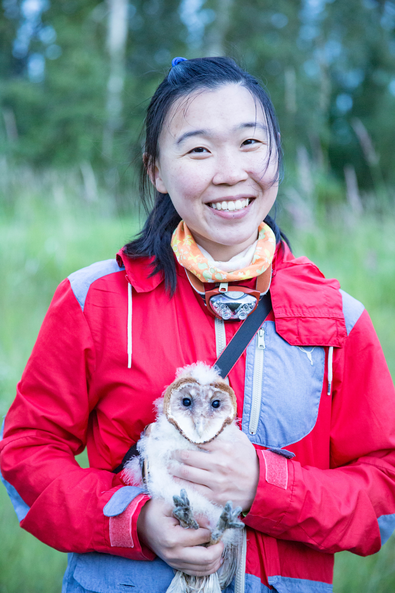
:::
:::::

## How about you

:::::: columns
:::: {.column width="35%"}
-   Your name

-   Experience with R

-   Spark bird

-   One thing want to do during IOC / in Merida?

::: fragment
> Nice to meet you all!
:::
::::

::: {.column width="65%"}

:::
::::::

::: aside
Artwork by [\@allison_horst](https://allisonhorst.com/), CC BY 4.0
:::

## Outline

1.  Analyzing audios with BirdNET in R (`birdnetR`, `birdnetTools`)
2.  Validating BirdNET detections in R (`birdnetTools`)
3.  Playing a game with BirdNET, in R!

. . .

> This workshop is meant to be a interactive session. So feel free to ask questions or share your experiences.

## Workshop rules

-   Your turn section

-   Stickers for practice time

-   Clone the repo for the code, slides, and dataset

-   Open the R project

-   Data? Follow along? Breaks? Practice (blue and red tags)

-   Copy code chunk instead of typing

-   For demo: slides/birdnet_analysis_example

-   For practice:

slides/practice_single_analysis slides/practice_batch_analysis slides/

-   This is for bonus slides :hot_pepper:
-   This is for your practice:owl:
-   This is the answer for the practice :key:

# Analyze audio with BirdNET in R

## Bioacoustics workflow

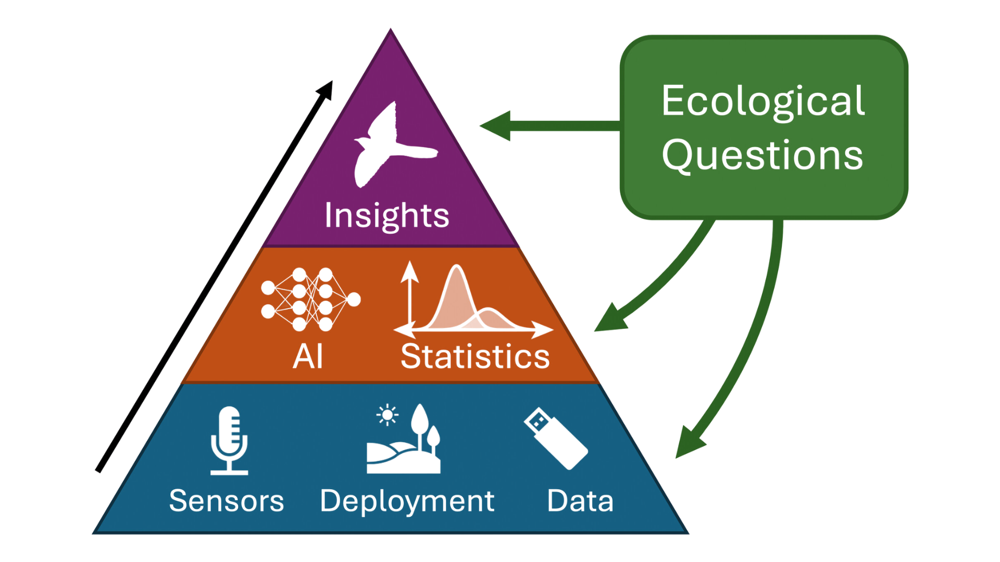

::: aside
Figure adapted from [Kitzes et al., 2026](https://besjournals.onlinelibrary.wiley.com/doi/full/10.1111/2041-210x.70133), Methods in Ecology and Evolution
:::

## Global model - BirdNET

[BirdNET.cornell.edu](https://birdnet.cornell.edu/)

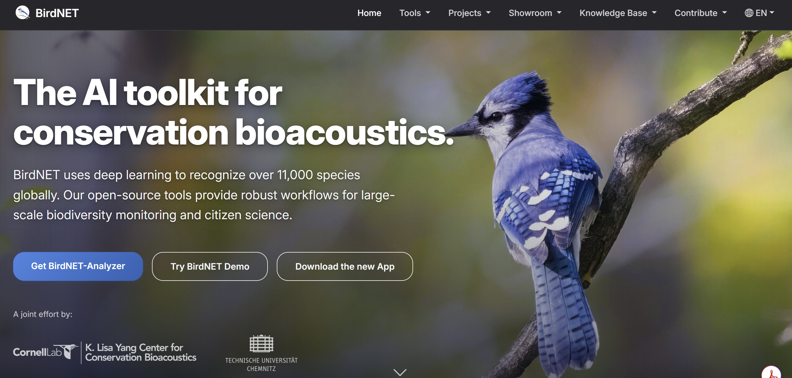

## What is BirdNET?

The AI toolkit for conservation bioacoustics

-   Developed by Cornell Lab of Ornithology **AND** Chemnitz University of Technology

-   Led by Stefan Kahl

-   First publication in 2021

-   CNN designed to classify sounds

-   Trained on [Macaulay library](https://www.macaulaylibrary.org/) and [Xeno-Canto](https://xeno-canto.org/)

-   Identifies 6,522 classes worldwide (model v2.4)

-   Open source on Github [BirdNET-Team](https://github.com/birdnet-team)

## How does BirdNET work?


## How does BirdNET work? (con'd)

A four-step architecture

1.  Capture
2.  Spectrogram
    -   It splits audio into 3-second segments

    -   Segments are converted into spectrograms (images)
3.  Neural Net
    -   Spectrograms are passed to CNN for image classification

    -   Detection of image patterns
4.  Result
    -   The output is a table, with **detected species** and **detection confidence**

    -   Geofencing output (species occurrence model based on eBird data)

## An example is worth a thousand words

::::: columns
::: {.column width="50%"}
**Input** - audio file

```{r}
#| eval: false

# Load the package
library(birdnetR)

# Load the BirdNET model
model <- load_birdnet()

# Path to the audio file
audio_path <- here(
  "slides", 
  "birdnet_analysis_example", 
  "20250609_000000.wav"
  )

# Predict species within the audio file
predictions <- predict(model, audio_path)

```

-   species detection + confidence
-   multi-species detections (3-6 sec)
:::

::: {.column width="50%"}
**Output** - detection table

```{r}
#| echo: false
#| message: false

if (file.exists("birdnet_results_single_analysis.rds")) {
  df <- readRDS("birdnet_results_single_analysis.rds")
} else {
  model <- load_birdnet()
  df <- predict(model, files = audio_path) |>
    as.data.frame()
  saveRDS(df, "birdnet_results_single_analysis.rds")
}

df |> 
select(-input) |>
datatable(
  options = list(
    scrollX = TRUE,
    scrollY = "400px",
    paging = FALSE,
    dom = "ft"
  ),
  class = "compact",
  rownames = FALSE
)

```
:::
:::::

## Running BirdNET in R

1.  The main package to run BirdNET in R is `birdnetR`. Load it with:

```{r}
library(birdnetR)
```

2.  Load the BirdNET model **once per R session** with `load_birdnet()`. The model files are downloaded in PC for first-time using (slow).

```{r}
#| eval: false
model <- load_birdnet()
```

3.  Identify the path to the audio file:

```{r}
audio_path <- here("slides", 
                   "birdnet_analysis_example", 
                   "20250609_000000.wav")
```

```{r}
#| echo: false

audio_path
```

4.  Then we could make predictions with `predict()` function:

```{r}
#| eval: false
predictions <- predict(model, audio_path)
```

## Running BirdNET in R (con'd)

The output is a list object in R, which can be viewed as a data frame:

```{r}
#| eval: false

predictions |> as.data.frame()
```

```{r}
#| echo: false
#| message: false

df <- readRDS("birdnet_results_single_analysis.rds")

df |> 
select(-input) |>
datatable(
  options = list(
    scrollX = TRUE,
    scrollY = "300px",
    paging = FALSE,
    dom = "ft"
  ),
  class = "compact",
  rownames = FALSE
)

```

> "`|>`" is called "pipe", a way to pass the output of one function to the next function. See [Ch18-Pipes](https://r4ds.had.co.nz/pipes.html) in R for Data Science.

## `birdnetR::predict()` arguments

::: panel-tabset
## Default

```{r}
#| eval: false
library(birdnetR)                               # step 1

model <- load_birdnet()                         # step 2 

audio_path <- here("slides",                    # step 3
                   "birdnet_analysis_example", 
                   "20250609_000000.wav") 

predictions <- predict(model, audio_path) |>    # step 4
  as.data.frame()
```

```{r}
#| echo: false
#| message: false
df <- readRDS("birdnet_results_single_analysis.rds")

df |> 
select(-input) |>
datatable(
  options = list(
    scrollX = TRUE,
    scrollY = "250px",
    paging = FALSE,
    dom = "ft"
  ),
  class = "compact",
  rownames = FALSE
)
```

## Confidence

```{r}
#| eval: false
predictions <- predict(model, audio_path, min_confidence = 0.3) |>
  as.data.frame()
```

```{r}
#| echo: false
#| message: false

if (file.exists("birdnet_results_single_analysis_conf.rds")) {
  df <- readRDS("birdnet_results_single_analysis_conf.rds")
} else {
  model <- load_birdnet()
  df <- predict(model, audio_path, min_confidence = 0.3) |>
    as.data.frame()
  saveRDS(df, "birdnet_results_single_analysis_conf.rds")
}

df |> 
select(-input) |>
datatable(
  options = list(
    scrollX = TRUE,
    scrollY = "100px",
    paging = FALSE,
    dom = "ft"
  ),
  class = "compact",
  rownames = FALSE
)

```

-   Default value of min_confidence is 0.1
-   This is a universal minimum confidence, not species-specific

## Lat / Lon

```{r}
#| eval: false
predictions <- predict(model, audio_path, latitude = 55.30, longitude = 20.99) |>
  as.data.frame()
```

```{r}
#| echo: false
#| message: false

if (file.exists("birdnet_results_single_analysis_lat_lon.rds")) {
  df <- readRDS("birdnet_results_single_analysis_lat_lon.rds")
} else {
  model <- load_birdnet()
  df <- predict(model, audio_path, latitude = 55.30, longitude = 20.99) |>
    as.data.frame()
  saveRDS(df, "birdnet_results_single_analysis_lat_lon.rds")
}

df |> 
select(-input) |>
datatable(
  options = list(
    scrollX = TRUE,
    scrollY = "300px",
    paging = FALSE,
    dom = "ft"
  ),
  class = "compact",
  rownames = FALSE
)

```

-   Species list calculated by distribution model (eBird) for the given lat/lon

## Week

```{r}
#| eval: false
predictions <- predict(model, audio_path, week = 22) |>
  as.data.frame()
```

```{r}
#| echo: false
#| message: false

if (file.exists("birdnet_results_single_analysis_week.rds")) {
  df <- readRDS("birdnet_results_single_analysis_week.rds")
} else {
  model <- load_birdnet()
  df <- predict(model, audio_path, week = 22) |>
    as.data.frame()
  saveRDS(df, "birdnet_results_single_analysis_week.rds")
}

df |> 
select(-input) |>
datatable(
  options = list(
    scrollX = TRUE,
    scrollY = "300px",
    paging = FALSE,
    dom = "ft"
  ),
  class = "compact",
  rownames = FALSE
)

```

-   Week is defined by "four weeks per month" (1 \~ 48)
-   For example, Mid June is week 22

## Species

```{r}
#| eval: false
predictions <- predict(model, audio_path, species_list = "Phalacrocorax carbo_Great Cormorant") |>
  as.data.frame()
```

```{r}
#| echo: false
#| message: false

if (file.exists("birdnet_results_single_analysis_species.rds")) {
  df <- readRDS("birdnet_results_single_analysis_species.rds")
} else {
  model <- load_birdnet()
  df <- predict(model, audio_path, species_list = "Phalacrocorax carbo_Great Cormorant") |>
    as.data.frame()
  saveRDS(df, "birdnet_results_single_analysis_species.rds")
}

df |> 
select(-input) |>
datatable(
  options = list(
    scrollX = TRUE,
    scrollY = "200px",
    paging = FALSE,
    dom = "ft"
  ),
  class = "compact",
  rownames = FALSE
)

```

-   Useful when your target species is a single or only a few speicies
:::

## `birdnetR::predict()` arguments (con'd)

::::: columns
::: {.column width="30%"}
```{r}
#| eval: false

??birdnetR::predict
```
:::

::: {.column width="70%"}

:::
:::::

## Your turn :owl:

⏱ 10 minutes

**Data:** `./practice_single_analysis/example_audio_single_analysis.mp3`

-   Which bird is the **dominant species** in this example recordings?
-   **Challenge:** set the location to Mérida. Does it change the result?

### Hint

```{r}
#| eval: false
library(birdnetR)
library(here)

model <- ___()

audio_path <- here("practice_single_analysis", "example_audio_single_analysis.mp3")

predictions <- predict(model, ___,
                       latitude = ___,  # Mérida: about 20.97
                       longitude = ___) # Mérida: about -89.61 (west is negative!)

predictions |> ___()
```

## Your turn :key:

Northern Bobwhite (*Colinus_nigrogularis*)!

```{r}
#| echo: false
#| message: false

if (file.exists(here("practice_single_analysis", "solution.rds"))) {
  df <- readRDS(here("practice_single_analysis", "solution.rds"))
} else {
  model <- load_birdnet()

  audio_path <- here("practice_single_analysis", 
                "example_audio_single_analysis.mp3")

  df <- predict(model, audio_path,
                       latitude = 20.97, 
                       longitude = -89.61) |>
    as.data.frame()
  saveRDS(df, here("slides", "practice_single_analysis", "solution.rds"))
}

df |> 
select(-input) |>
datatable(
  options = list(
    scrollX = TRUE,
    scrollY = "150px",
    paging = FALSE,
    dom = "ft"
  ),
  class = "compact",
  rownames = FALSE
)

```

### Solution

```{r}
#| eval: false
library(birdnetR)
library(here)

model <- load_birdnet()

audio_path <- here("practice_single_analysis", "example_audio_single_analysis.mp3")

predictions <- predict(model, audio_path,
                       latitude = 20.97, 
                       longitude = -89.61)

predictions |> as.data.frame()
```

## Often, we need batch analysis

Research projects usually consists of more than single audio

-   Recordings from hundreds of recorders, with months of data

-   Batch analysis can be done by...

    1.  Raven Pro
    2.  GUI
    3.  Python package `birdnet`
    4.  R package `birdnetR`

## Batch analysis in R

In step 3 - identify multiple audio paths:

```{r}
audio_paths <- here("slides", "birdnet_analysis_example") |>
  list.files(pattern = "\\.(mp3|wav)$", full.names = TRUE, ignore.case = TRUE)
```

```{r}
#| echo: false
audio_paths
```

## Batch analysis in R (con'd)

In step 4 - pass to `predict`:

```{r}
#| eval: false
predictions <- predict(model, audio_paths) |>
  as.data.frame()

```

```{r}
#| echo: false
#| message: false

if (file.exists("birdnet_results_batch_analysis.rds")) {
  df <- readRDS("birdnet_results_batch_analysis.rds")
} else {
  model <- load_birdnet()
  df <- predict(model, audio_paths) |>
    as.data.frame()
  saveRDS(df, "birdnet_results_batch_analysis.rds")
}

df |> 
datatable(
  options = list(
    scrollX = TRUE,
    scrollY = "400px",
    paging = FALSE,
    dom = "ft"
  ),
  class = "compact",
  rownames = FALSE
)

```

Use the file name to seperate each recordings - Easy! :heart:

## Batch analysis from other tools

::::: columns
::: {.column width="70%"}
-   birdnetR: output is already in R

-   Other tools (e.g., BirdNET GUI)

    -   results are saved as files in output folder

    -   with a structure like this:

-   **How to post-process BirdNET results in R?**

    -   Importing

    -   Exploring (visualization, trend, ...)

    -   Validation, etc.

-   **`birdnetTools`**
:::

::: {.column width="30%"}
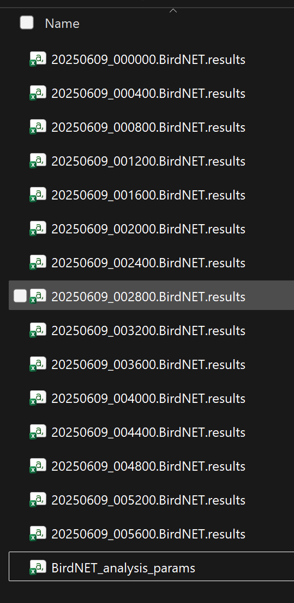
:::
:::::

## Working with BirdNET output

::::: columns
::: {.column width="70%"}
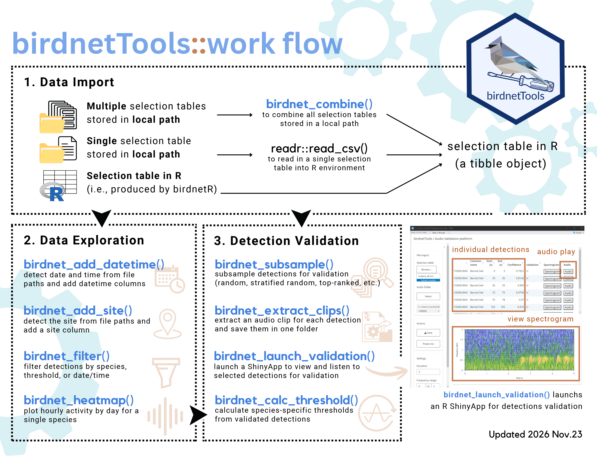
:::

::: {.column width="30%"}
Load `birdnetTools`:

```{r}
library(birdnetTools)
```
:::
:::::

## Data import

1.  Identify the path to the BirdNET output folder:

```{r}
output_path <- here("slides", "birdnet_analysis_example_output")
```

```{r}
#| echo: false
output_path
```

2.  Import the BirdNET output with `birdnet_combine()`:

```{r}
#| message: true
#| cache: true
predictions <- birdnet_combine(output_path)
```

```{r}
#| echo: false
predictions |> 
  datatable(
    options = list(
      scrollX = TRUE,
      scrollY = "150px",
      paging = FALSE,
      dom = "ft"
    ),
    class = "compact",
    rownames = FALSE
  )
```

## Data exploration

Sometimes we need more than just the detection. For example...

1.  Add date and time information with `birdnet_add_datetime()`:

```{r}
#| message: true
predictions_datetime <- birdnet_add_datetime(predictions)
```

-   This function automatically detects the date / time from the file name

-   And mutates eight date / time columns:

```{r}
#| echo: false
predictions_datetime |> 
  datatable(
    options = list(
      scrollX = TRUE,
      scrollY = "200px",
      paging = FALSE,
      dom = "ft"
    ),
    class = "compact",
    rownames = FALSE
  )
```

## Data exploration (con'd) :hot_pepper:

-   Default setting of `birdnet_add_datetime()` covers most of the formats:

```{r}
formals(birdnet_add_datetime)$formats
```

-   But, if the datetime format is special, it could fail:

```{r}
#| message: true
predictions_fail <- predictions[1:3,] |> 
  dplyr::mutate(File = c("E:\\Audio\\2023_passerine\\14_18\\00014530_20230518T1335.WAV",
                         "E:\\Audio\\2023_passerine\\14_18\\051820231335.WAV",
                         "E:\\Audio\\2023_passerine\\14_18\\18052023133500.WAV"))

birdnet_add_datetime(predictions_fail)
```

## Data exploration (con'd) :hot_pepper:

-   Set customized format with the `formats` argument:

```{r}
#| message: true
predictions_fail |> birdnet_add_datetime(formats = c("%Y%m%dT%H%M",  # <- user-defined format
                                                     "%m%d%Y%H%M",
                                                     "%d%m%Y%H%M%S"))
```

## Data exploration (con'd)

2.  Add location information with `birdnet_add_site()`:

```{r}
#| message: true
#| cache: true

predictions_site <- birdnet_add_site(predictions, i = -2)

```

```{r}
#| echo: false
#| cache: true

predictions_site <- example_jprf_2023[1:20, ] |>
  birdnet_add_site(i = -2)

predictions_site |> 
  select(filepath, start, end, scientific_name, common_name, site) |>
  datatable(
    options = list(
      scrollX = TRUE,
      scrollY = "300px",
      paging = FALSE,
      dom = "ft"
    ),
    class = "compact",
    rownames = FALSE
  )
```

-   Recordings from the same site should be in the same folder, and the folder name has to contain the site name

## Data exploration (con'd)

3.  Filter the detection with `birdnet_filter()`:

::: panel-tabset
## by species

```{r}
predictions_filtered <- birdnet_filter(predictions,
                                       species = c("Great Cormorant", "Wood Thrush"))
```

```{r}
#| echo: false
df <- predictions_filtered

df |> 
datatable(
  options = list(
    scrollX = TRUE,
    scrollY = "200px",
    paging = FALSE,
    dom = "ft"
  ),
  class = "compact",
  rownames = FALSE
)
```

## by threshold

```{r}
predictions_filtered <- birdnet_filter(predictions,
                                       species = c("Great Cormorant", "Wood Thrush"),
                                       threshold = 0.4)
```

```{r}
#| echo: false
df <- predictions_filtered

df |> 
datatable(
  options = list(
    scrollX = TRUE,
    scrollY = "200px",
    paging = FALSE,
    dom = "ft"
  ),
  class = "compact",
  rownames = FALSE
)
```

## by time

```{r}
predictions_filtered <- birdnet_filter(predictions,
                                       species = c("Great Cormorant", "Wood Thrush"),
                                       threshold = 0.4,
                                       year = 2025)
```

```{r}
#| echo: false
df <- predictions_filtered

df |> 
datatable(
  options = list(
    scrollX = TRUE,
    scrollY = "200px",
    paging = FALSE,
    dom = "ft"
  ),
  class = "compact",
  rownames = FALSE
)
```

## full options

```{r}
#| eval: false
?birdnet_filter()
```

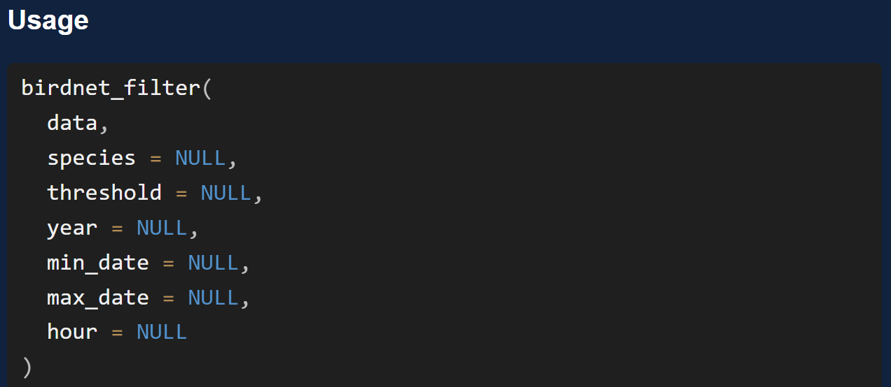
:::

## Data exploration (con'd) :hot_pepper:

4.  Quick visualization with `birdnet_heatmap()`:

```{r}
#| cache: true

predictions <- example_jprf_2023

birdnet_heatmap(predictions, species = "Swainson's Thrush")

```

## Your turn :owl:

⏱ 10 minutes

**Data:** `./practice_batch_analysis/`

-   Which date was the recordings collected from?
-   How many detections does Great Cormorant have, with confidence \> 0.3?

### Hint

```{r}
#| eval: false
library(birdnetTools)
library(here)

predictions <- birdnet_combine(here("practice_batch_analysis"))

birdnet_add_datetime(___)

birdnet_filter(predictions,
               species = ___,
               ___ = 0.3)
```

## Your turn :key:

-   2025 Jun. 9th!
    -   BTW, my birthday!
-   Four detections :)

### Solution

```{r}
#| eval: false
library(birdnetTools)
library(here)

predictions <- birdnet_combine(here("slides", "practice_batch_analysis"))

birdnet_add_datetime(predictions)

birdnet_filter(predictions,
               species = "Great Cormorant",
               threshold = 0.3)
```

# Data validation

## Why do we need to validate detections?

::::: columns
::: {.column width="40%"}
-   BirdNET is not perfect
-   Differs by bird species
-   Validation - peak into that imperfection
-   Four types of **predictions results**:
:::

::: {.column width="60%"}
```{r}
#| echo: false
#| cache: true
#| dev: ragg_png
#| fig-width: 7.5
#| fig-height: 6.1
#| fig-align: center
library(ggplot2)

confusion_plot <- function(col_icons    = c("☀️", "☁️"),   # prediction: left, right
                           row_icons    = c("☁️", "☀️"),   # reality: top, bottom
                           reporter     = "💁",            # the forecaster
                           observer     = "🔭",            # emoji fallback
                           observer_img = NULL,            # e.g. "images/binoculars.png"
                           label_size   = 20,
                           icon_size    = 20,
                           person_size  = 26) {

  tiles <- data.frame(
    x     = c(1, 2, 1, 2),
    y     = c(2, 2, 1, 1),
    label = c("FP", "TN", "TP", "FN")
  )

  p <- ggplot(tiles, aes(x, y)) +
    geom_tile(aes(fill = label), width = 0.95, height = 0.95,
              colour = "black", linewidth = 1) +
    geom_text(aes(label = label), size = label_size, fontface = "bold") +

    # prediction icons below the columns, reporter beside them (right)
    annotate("text", x = 1:2,  y = 0.27, label = col_icons, size = icon_size) +
    annotate("text", x = 2.5,  y = 0.27, label = reporter,  size = person_size) +

    # reality icons left of the rows
    annotate("text", x = 0.28, y = c(2, 1), label = row_icons, size = icon_size) +

    scale_fill_manual(values = c(FP = "#26dc7d", TN = "#dd4f82",
                                 TP = "#0fc8f2", FN = "#fada68")) +
    coord_equal(xlim = c(0.0, 2.85), ylim = c(0.05, 2.55),
                expand = FALSE, clip = "off") +
    theme_void() +
    theme(legend.position = "none",
          plot.margin = margin(0, 0, 0, 0))

  # observer: directly below the row icons (bottom-left corner)
  if (is.null(observer_img)) {
    p + annotate("text", x = 0.28, y = 0.27, label = observer, size = person_size)
  } else {
    p + ggimage::geom_image(
      data = data.frame(x = 0.28, y = 0.27, image = observer_img),
      aes(x, y, image = image), size = 0.14, inherit.aes = FALSE
    )
  }
}

confusion_plot()
```
:::
:::::

## Two types of accuracy

```{r}
#| echo: false

#| echo: false

cm_colors <- c(FP = "#26dc7d", TN = "#dd4f82", TP = "#0fc8f2", FN = "#fada68")

# num = one label (e.g. "FP"); den = two labels (e.g. c("FN", "FP"))
fraction_plot <- function(num, den, label_size = 14) {

  tiles <- data.frame(
    x     = c(1.0, 2.7, 4.4),
    y     = c(1.0, 1.0, 1.0),
    label = c(num, den),
    stringsAsFactors = FALSE
  )

  ggplot(tiles, aes(x, y)) +
    geom_tile(aes(fill = label), width = 0.85, height = 0.85,
              colour = "black", linewidth = 1) +
    geom_text(aes(label = label), size = label_size*1.2, fontface = "bold") +
    annotate("text", x = 1.85, y = 1.0, label = "/",
             size = label_size * 1.5, fontface = "bold") +
    annotate("text", x = 3.55, y = 1.0, label = "+",
             size = label_size, fontface = "bold") +
    scale_fill_manual(values = cm_colors) +
    coord_equal(xlim = c(0.4, 5.0), ylim = c(0.4, 1.6), expand = FALSE) +
    theme_void() +
    theme(legend.position = "none", plot.margin = margin(0, 0, 0, 0))
}
```

::::::: columns
::: {.column width="40%"}
```{r}
#| echo: false
#| dev: ragg_png
#| fig-width: 7.5
#| fig-height: 6.1
#| out-width: 100%
confusion_plot()
```
:::

::::: {.column width="60%"}
::: fragment
### Precision

When the weather forecast says it's sunny, how likely is that statement to be true?

```{r}
#| echo: false
#| fig-width: 5
#| fig-height: 1.8
#| out-width: 45%
fraction_plot("TP", c("FP", "TP"))
```
:::

::: fragment
### Recall

When it's sunny, how likely is it that the forecast accurately predicted the sun?

```{r}
#| echo: false
#| fig-width: 5
#| fig-height: 1.8
#| out-width: 45%
fraction_plot("TP", c("FN", "TP"))
```
:::
:::::
:::::::

## Accuracy in bird context

We need to know if the audio actually contains the target bird species

-   Prediction - BirdNET

-   Observed - human validation

-   Then we can assign the detection to one of FP/TP/TN/FN

-   Validate many detections -\> get precision and recall

## Accuracy in bird context

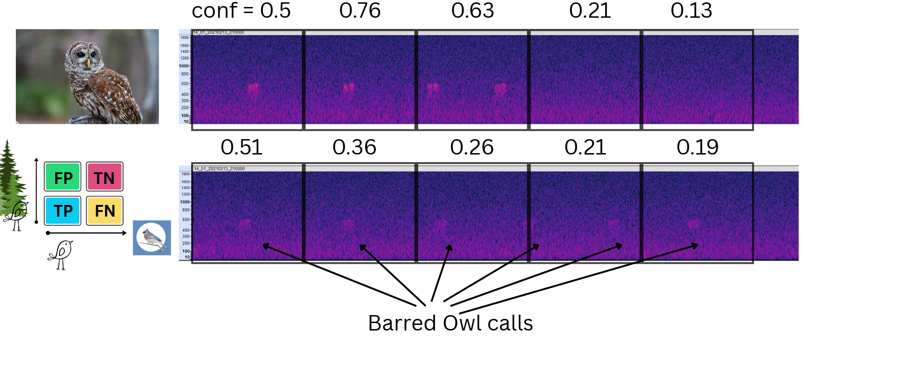

## Accuracy in bird context

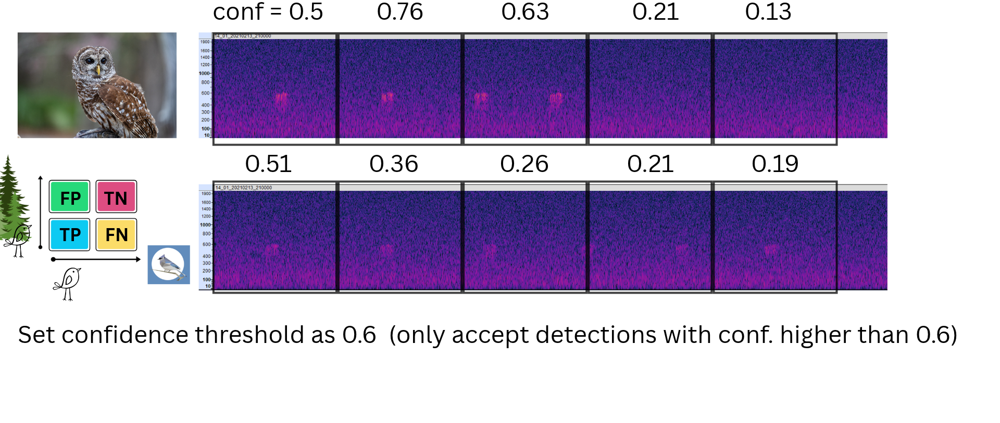

## Accuracy in bird context

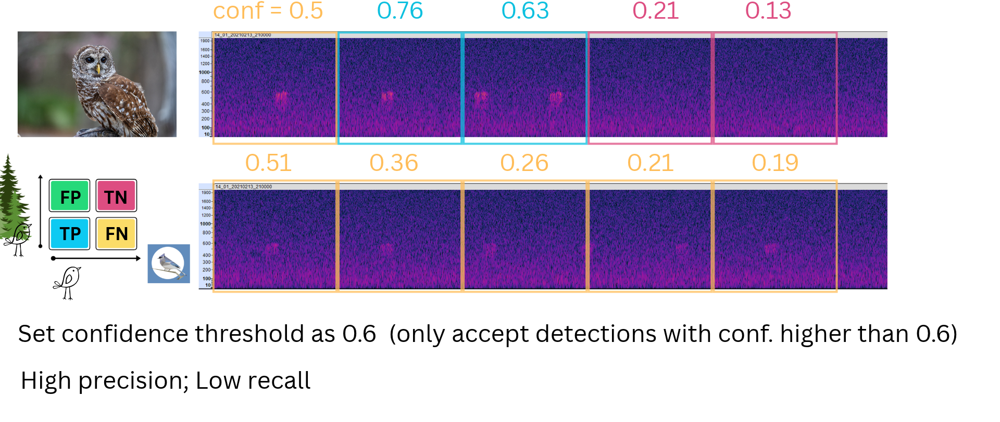

## Accuracy in bird context


## Accuracy in bird context

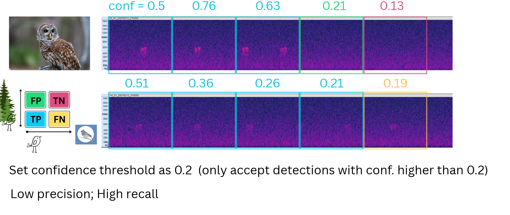

## Validation in R

There are four functions in `birdnetTools` to do validation in R

1.  **Subsample** the detections to validate with `birdnet_subsample()`

2.  **Extract** a short audio clip for each of them into one folder with `birdnet_extract_clips()`

3.  **Validate** the clips in a Shiny app launched by `birdnet_launch_validation()`

4.  **Calculate** a species-specific threshold with `birdnet_calc_threshold()`


> Full instructins can be found in [`birdnetTools` documentation](https://birdnet-team.github.io/birdnetTools/articles/birdnetTools.html#validating-detections)


## Validate clips in R :hot_pepper:

- Subsampled detections for validate: `./practice_vlidation/`
- For those who are curious how I created the folder:

```{r}
#| eval: false
detections <- birdnet_combine(here("practice_batch_analysis"))

detections |>
  birdnet_filter(species = "Red-breasted Flycatcher") |>
  birdnet_subsample(n = 10, seed = 123) |>
  birdnet_extract_clips(audio_dir = here("slides", "birdnet_analysis_example"),
                        output_dir = here("practice_vlidation"))
```


- We want to label each detection as **TP** (accurate) or **FP** (false positive) 
- Run `birdnet_launch_validation()` to open the Shiny validation app

```{r}
#| eval: false

birdnet_launch_validation()
```


## Validate clips in R :hot_pepper:


## Validate clips in R :hot_pepper:

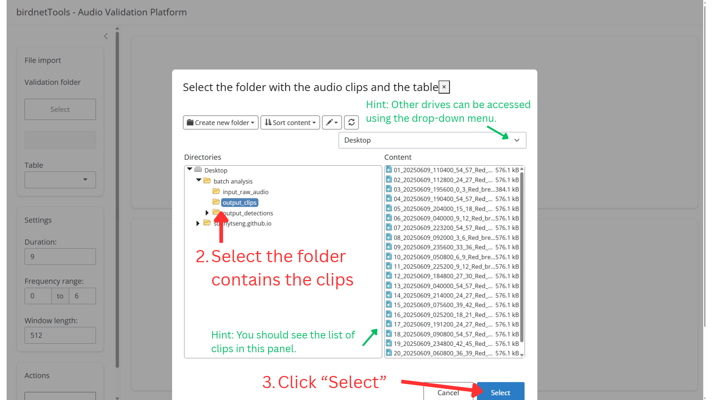

## Validate clips in R :hot_pepper:


## Validate clips in R :hot_pepper:

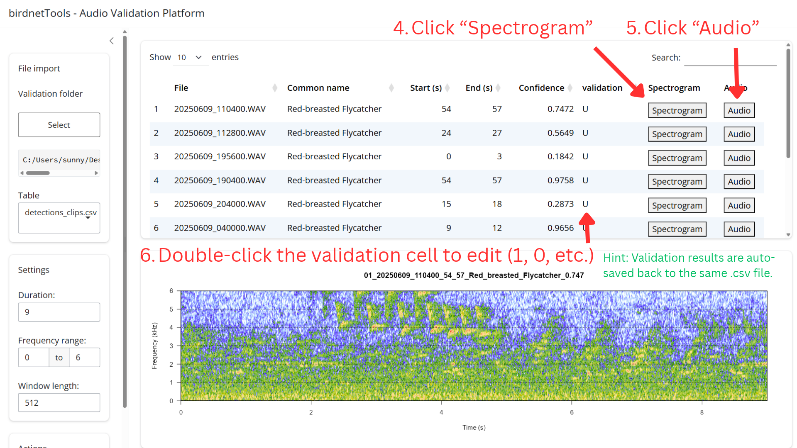


## Your turn :owl:

⏱ 10 minutes

**Data:** `./practice_vlidation/`

-   Import the folder
-   Visualize / listen to the detections
-   **Challenge**: Edit the vlidation result, check CSV

### Hint

```{r}
#| eval: false

birdnet_launch_validation()
```


## Your turn :key:


### Solution

```{r}
#| eval: false

birdnet_launch_validation()
```

# Play a game with BirdNET, in R! :hot_pepper:

## Beat the BirdNET :bird:

A bird guessing game, designed with BirdNET

### How to play

1.  **Player A** picks a random recording
2.  **The Group** listens and guesses the species
3.  **BirdNET** reveals its guess
4.  We see who is right! :heart:

### How I made the game

1. Explore / download Mérida birds on Xeno-Canto → `suwo`

2. Read and check the audio in R → `tuneR`, `seewave`

3. Identify species with BirdNET → `birdnetR`

## Step 1: Explore bird sounds

[Xeno-Canto](https://xeno-canto.org): \~1 million wildlife recordings, shared under CC licenses

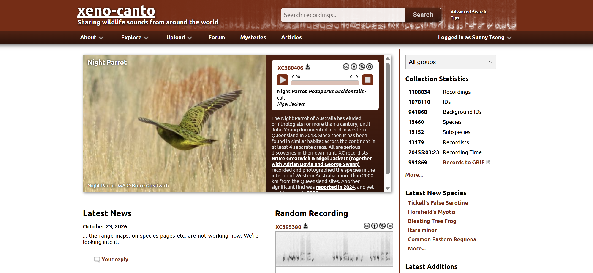

## Query Merida recordings

Use the `query_xenocanto()` function from the `suwo` package:

```{r}
library(suwo)
```

Merida area, songs, high quality recordings (109 recordings from 47 species):

```{r}
#| cache: true
#| 
Merida_birds <- query_xenocanto(species = 'lat: "20.97" lon: "-89.61" type: "song" q:">C"')
```

```{r}
#| echo: false

Merida_birds |>
mutate(number = row_number()) |>
select(number, key, species, date, time, user_name, locality, file_extension) |>
datatable(
  options = list(
    scrollX = TRUE,      # horizontal scroll (many columns)
    scrollY = "400px",   # vertical scroll within this height
    paging = FALSE,      # show all rows in the scroll box
    dom = "ft"           # just the filter box + table
  ),
  class = "compact",
  rownames = FALSE
)
```

## Download and read into R

Use the `download_media()` function from the `suwo` package:

Batch download:

```{r}
#| echo: false
audio_dir <- here("slides", "audio")
dir.create(audio_dir, showWarnings = FALSE)
```

```{r}
#| cache: true
#| message: true
download_media(metadata = Merida_birds |> head(6),
               path = audio_dir)
```

## Step 2: Read and check audio in R

Use the `readWave()` or `readMP3()` function from the `tuneR` package:

```{r}
library(tuneR)
```

Let's read one audio in the `audio_dir` folder:

```{r}
audio_path <- tibble(path = list.files(audio_dir, pattern = "\\.(mp3|wav)$",
                                 full.names = TRUE, ignore.case = TRUE)) |>
  mutate(modified = file.mtime(path)) |>
  slice_min(modified, n = 1) |> 
  pull(path)

audio_path
```

Check the file extension and read it accordingly:

```{r}
ext <- tolower(tools::file_ext(audio_path))

if (ext == "mp3") {
  audio <- readMP3(audio_path)
} else if (ext == "wav") {
  audio <- readWave(audio_path)
}
```

## Listen

To listen, use the `play()` function from the `tuneR` package:

```{r}
library(tuneR)
```

Indicate the audio object:

```{r}
#| eval: false
audio |> 
  play()
```

```{r}
#| echo: false
htmltools::tags$audio(src = file.path("audio", basename(audio_path)),
           controls = "controls")
```

## Look

To visualize, use the `spectro()` function from the `seewave` package:

```{r}
library(seewave)
```

Indicate the audio abject:

```{r}
#| fig-width: 28
#| out-width: "100%"
audio |>
  extractWave(from = 2, to = 11, xunit = "time") |>
  spectro(flim = c(2, 9),
          fastdisp = TRUE)
```

-   **x-axis**: time, **y-axis**: pitch, **darkness**: loudness
-   Every species has a "shape" you can learn to read

## Step 3: What does the BirdNET say?

Use the `predict()` function from the `birdnetR` package.

```{r}
library(birdnetR)
```

Load model and run prediction:

```{r}
#| eval: false
model <- load_birdnet()

predictions <- predict(model,
                       files = audio_path,
                       min_confidence = 0.3)
```

```{r}
#| echo: false
#| message: false
if (file.exists("birdnet_results.rds")) {
  df <- readRDS("birdnet_results.rds")
} else {
  model <- load_birdnet()
  df <- predict(model, files = audio_path, min_confidence = 0.3) |>
    as.data.frame()
  saveRDS(df, "birdnet_results.rds")
}

df |> 
select(-input) |>
datatable(
  options = list(
    scrollX = TRUE,
    scrollY = "400px",
    paging = FALSE,
    dom = "ft"
  ),
  class = "compact",
  rownames = FALSE
)

```

## Put everything together

### How to play

1.  **Player A** picks a random recording
2.  **The Group** listens and guesses the species
3.  **BirdNET** reveals its guess
4.  We see who is right! :heart:

> Ready to "Beat the BirdNET"? :video_game:

## Final peek for our answer sheet

A total of 109 recordings from 47 species

```{r}
#| echo: false

Merida_birds |>
mutate(number = row_number()) |>
select(number, key, species, date, time, user_name, locality, file_extension) |>
datatable(
  options = list(
    scrollX = TRUE,      # horizontal scroll (many columns)
    scrollY = "400px",   # vertical scroll within this height
    paging = FALSE,      # show all rows in the scroll box
    dom = "ft"           # just the filter box + table
  ),
  class = "compact",
  rownames = FALSE
)
```

```{r}
#| echo: false
#| message: false

birdnet <- list.files(here("slides", "audio_game_output"),
                      pattern = "\\.BirdNET\\.results\\.csv$",
                      full.names = TRUE) |>
  read_csv(id = "csv_file", show_col_types = FALSE) |>
  mutate(base = str_extract(basename(csv_file), "^[^.]+")) |>
  select(base,
         start       = `Start (s)`,
         end         = `End (s)`,
         common_name = `Common name`,
         scientific  = `Scientific name`,
         confidence  = Confidence) |>
  arrange(base, start)

game <- Merida_birds |>
  mutate(base  = paste0(str_replace_all(species, " ", "_"), "-XC", key),
         audio = file.path("audio_game", paste0(base, ".", file_extension)),
         spec  = file.path("audio_game_spectrogram", paste0(base, ".png"))) |>
  mutate(id = row_number()) |>
  select(id, base, species, key, user_name, locality, audio, spec)

ojs_define(game = game, birdnet = birdnet)
```

## :video_game: Who's singing?

```{ojs}
//| echo: false
birds = transpose(game)

viewof i = Inputs.number([1, birds.length],
  {step: 1, value: 1, label: `Pick a number (1–${birds.length})`})

bird = birds[i - 1]

html`<audio controls src="${bird.audio}" style="width:100%"></audio>`

html``

detections = transpose(birdnet).filter(d => d.base === bird.base)
```

## :bird: And the answer is...

```{ojs}
//| echo: false
md`**BirdNET says:**`

detections.length === 0
  ? md`No detection`
  : Inputs.table(detections, {
  columns: ["start", "end", "common_name", "scientific", "confidence"],
  header: {start: "Start (s)", end: "End (s)", common_name: "Common name",
           scientific: "Scientific name", confidence: "Confidence"},
  format: {confidence: x => x.toFixed(2)},
  height: 350})
  
md`**Xeno-Canto label (the answer):** 

*${bird.species}*, recorded by ${bird.user_name} (XC${bird.key})`

```

## Hope you had fun!

Having fun is probably most important above all! :)


## Recap: BirdNET in R

### `birdnetR`
1. Single / batch analysis

### `birdnetTools`
2. Import detection results 
3. Explore (add metadata, filter, visualize) 
4. Vlidate detections

## Recap: BirdNET in R (con'd)


## Thank you

Sunny Tseng, independent ecological consultant
Contact: sunny@sunnytseng.ca
Website: sunnytseng.ca


> Enjoy the conference!

> Card, sticker and photo? 

::: aside
Presentation by Sunny Tseng <https://sunnytseng.ca/>, CC BY 4.0

Travel funds: East and Southeast Asia Travel Fund for Ornithology
:::

