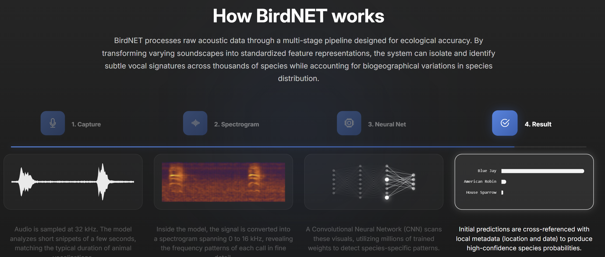
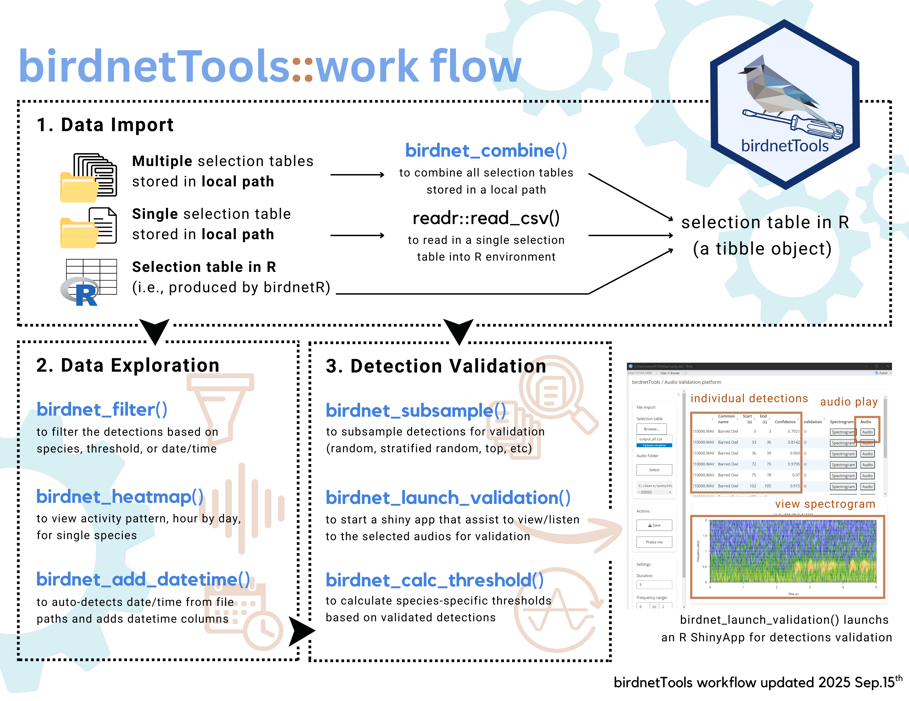

```{r}
#| echo: false
#| warning: false
#| message: false

library(tidyverse)
library(here)
library(DT)
```

## House keeping

-   WIFI: xyz (pwd: 12345678)

-   Workshop Github:

-   Data? Follow along? Breaks? Practice (blue and red tags)

## About me

::::: columns
::: {.column width="65%"}
-   Independent data consultant

-   R user since 2015

    -   script --\> shinyR --\> rmarkdown --\> quarto --\> package development

    -   using AI agent in R

-   Sound recording

-   Hip hop dancing
:::

::: {.column width="35%"}

:::
:::::

## How about you

:::::: columns
:::: {.column width="35%"}
-   Your name

-   Experience with R

-   Spark bird

-   One thing want to do during IOC / in Merida?

::: fragment
> Nice to meet you all!
:::
::::

::: {.column width="65%"}

:::
::::::

::: aside
Artwork by [\@allison_horst](https://allisonhorst.com/), CC BY 4.0
:::

## Outline

1.  Analyzing audios with BirdNET in R (`birdnetR`, `birdnetTools`)
2.  Validating BirdNET detections in R (`birdnetTools`)
3.  Playing a game with BirdNET, in R!

. . .

> This workshop is meant to be a interactive session. So feel free to ask questions or share your experiences.

# Analyze audios with BirdNET in R

## Bioacoustics workflow


::: aside
Figure adapted from [Kitzes et al., 2026](https://besjournals.onlinelibrary.wiley.com/doi/full/10.1111/2041-210x.70133), Methods in Ecology and Evolution
:::

## Global model - BirdNET

[BirdNET.cornell.edu](https://birdnet.cornell.edu/)


## What is BirdNET?

The AI toolkit for conservation bioacoustics

-   Developed by Cornell Lab of Ornithology **AND** Chemnitz University of Technology

-   Main developer: Stefan Kahl, in 2016

-   First publication in 2021

-   CNN designed to classify sounds

-   Trained on [Macaulay library](https://www.macaulaylibrary.org/) and [Xeno-Canto](https://xeno-canto.org/)

-   Identify 6,522 classes worldwide (model v2.4)

-   Open source on Github [BirdNET-Team](https://github.com/birdnet-team)

## How does BirdNET work?

A four steps architecture

1.  Capture
2.  Spectrogram
    -   It splits audio into 3-secs segments

    -   Segments are converted into spectrograms (images)
3.  Neural Net
    -   Spectrograms are passed to CNN for image classification

    -   Detection of image patterns
4.  Result
    -   The output is a table, with **detected species** and **detection confidence**

    -   Output can be filtered by geofencing (distribution model by eBird)

## How does BirdNET work?



## A quick view of input / output

## Running BirdNET in R

The main package to run BirdNET in R is `birdnetR`

```{r}
library(birdnetR)
```

The first time using this package, use `load_birdnet()` to load models:

```{r}
#| eval: false
model <- load_birdnet()
```

Then we could make predictions with `predict()` function:
```{r}
audio_path <- here("slides", "birdnet_example", "example.wav")
```

## Parameters

- species list (lat, lon, species)
- confidence value
- sensitivity, etc


## Batch analysis


## Your turn - 1

- using Merida lat, lon, and year long species list
- confidence value 0.1

- Which bird is the dominant species among all the example recordings?
- Harder question - How many detections are there in total? 


## A complete stack for research 

BirdNET is not only a model, but a toolkit can be accessed by...

1.  **R packages**
2.  Online platform
3.  Raven Pro
4.  Phone apps
5.  GUI
6.  Python package


## Import BirdNET output into R
- If birdnetR, then the output is in R already. 
- If other tools (e.g., GUI, Raven Pro), then need to import the output into R. 


## Your turn - 2


# Validate BirdNET detections in R


## Your turn - 3


# Play a game with BirdNET, in R!

## Beat the BirdNET :bird:

A bird guessing game, designed with BirdNET

### How to play

1.  **Player A** picks a random recording
2.  **The Group** listens and guesses the species
3.  **BirdNET** reveals its guess
4.  We see who is right! :heart:

### How I made the game

**Step 1.** Explore / download Mérida birds on Xeno-Canto → `suwo`

**Step 2.** Read and check the audio in R → `tuneR`, `seewave`

**Step 3.** Identify species with BirdNET → `birdnetR`

## Step 1: Explore bird sounds

[Xeno-Canto](https://xeno-canto.org): \~1 million wildlife recordings, shared under CC licenses


## Query Merida recordings

Use the `query_xenocanto()` function from the `suwo` package:

```{r}
library(suwo)
```

Merida area, songs, high quality recordings (109 recordings from 47 species):

```{r}
#| cache: true
Merida_birds <- query_xenocanto(species = 'lat: "20.97" lon: "-89.61" type: "song" q:">C"')
```

```{r}
#| echo: false

Merida_birds |>
mutate(number = row_number()) |>
select(number, key, species, date, time, user_name, locality, file_extension) |>
datatable(
  options = list(
    scrollX = TRUE,      # horizontal scroll (many columns)
    scrollY = "400px",   # vertical scroll within this height
    paging = FALSE,      # show all rows in the scroll box
    dom = "ft"           # just the filter box + table
  ),
  class = "compact",
  rownames = FALSE
)
```

## Download and read into R

Use the `download_media()` function from the `suwo` package:

Batch download:

```{r}
#| echo: false
audio_dir <- here("slides", "audio")
dir.create(audio_dir, showWarnings = FALSE)
```

```{r}
#| cache: true
#| message: true
download_media(metadata = Merida_birds |> head(6),
               path = audio_dir)
```

## Step 2: Read and check audio in R

Use the `readWave()` or `readMP3()` function from the `tuneR` package:

```{r}
library(tuneR)
```

Let's read one audio in the `audio_dir` folder:

```{r}
audio_path <- tibble(path = list.files(audio_dir, pattern = "\\.(mp3|wav)$",
                                 full.names = TRUE, ignore.case = TRUE)) |>
  mutate(modified = file.mtime(path)) |>
  slice_min(modified, n = 1) |> 
  pull(path)

audio_path
```

Check the file extension and read it accordingly:

```{r}
ext <- tolower(tools::file_ext(audio_path))

if (ext == "mp3") {
  audio <- readMP3(audio_path)
} else if (ext == "wav") {
  audio <- readWave(audio_path)
}
```

## Listen

To listen, use the `play()` function from the `tuneR` package:

```{r}
library(tuneR)
```

Indicate the audio object:

```{r}
#| eval: false
audio |> 
  play()
```

```{r}
#| echo: false
htmltools::tags$audio(src = file.path("audio", basename(audio_path)),
           controls = "controls")
```

## Look

To visualize, use the `spectro()` function from the `seewave` package:

```{r}
library(seewave)
```

Indicate the audio abject:

```{r}
#| fig-width: 28
#| out-width: "100%"
audio |>
  extractWave(from = 2, to = 11, xunit = "time") |>
  spectro(flim = c(2, 9),
          fastdisp = TRUE)
```

-   **x-axis**: time, **y-axis**: pitch, **darkness**: loudness
-   Every species has a "shape" you can learn to read

## Step 3: What does the BirdNET say?

Use the `predict()` function from the `birdnetR` package.

```{r}
library(birdnetR)
```

Load model and run prediction:

```{r}
#| eval: false
model <- load_birdnet()

predictions <- predict(model,
                       files = audio_path,
                       min_confidence = 0.3)
```

```{r}
#| echo: false
#| messages: false

if (file.exists("birdnet_results.rds")) {
  df <- readRDS("birdnet_results.rds")
} else {
  model <- load_birdnet()
  df <- predict(model, files = audio_path, min_confidence = 0.3) |>
    as.data.frame()
  saveRDS(df, "birdnet_results.rds")
}

df |> 
select(-input) |>
datatable(
  options = list(
    scrollX = TRUE,
    scrollY = "400px",
    paging = FALSE,
    dom = "ft"
  ),
  class = "compact",
  rownames = FALSE
)

```

## Put everything together

### How to play

1.  **Player A** picks a random recording
2.  **The Group** listens and guesses the species
3.  **BirdNET** reveals its guess
4.  We see who is right! :heart:

> Ready to "Beat the BirdNET"? :video_game:

## Final peek for our answer sheet

A total of 109 recordings from 47 species

```{r}
#| echo: false

Merida_birds |>
mutate(number = row_number()) |>
select(number, key, species, date, time, user_name, locality, file_extension) |>
datatable(
  options = list(
    scrollX = TRUE,      # horizontal scroll (many columns)
    scrollY = "400px",   # vertical scroll within this height
    paging = FALSE,      # show all rows in the scroll box
    dom = "ft"           # just the filter box + table
  ),
  class = "compact",
  rownames = FALSE
)
```

```{r}
#| echo: false
#| message: false

birdnet <- list.files(here("slides", "audio_game_output"),
                      pattern = "\\.BirdNET\\.results\\.csv$",
                      full.names = TRUE) |>
  read_csv(id = "csv_file", show_col_types = FALSE) |>
  mutate(base = str_extract(basename(csv_file), "^[^.]+")) |>
  select(base,
         start       = `Start (s)`,
         end         = `End (s)`,
         common_name = `Common name`,
         scientific  = `Scientific name`,
         confidence  = Confidence) |>
  arrange(base, start)

game <- Merida_birds |>
  mutate(base  = paste0(str_replace_all(species, " ", "_"), "-XC", key),
         audio = file.path("audio_game", paste0(base, ".", file_extension)),
         spec  = file.path("audio_game_spectrogram", paste0(base, ".png"))) |>
  mutate(id = row_number()) |>
  select(id, base, species, key, user_name, locality, audio, spec)

ojs_define(game = game, birdnet = birdnet)
```

## :video_game: Who's singing?

```{ojs}
//| echo: false
birds = transpose(game)

viewof i = Inputs.number([1, birds.length],
  {step: 1, value: 1, label: `Pick a number (1–${birds.length})`})

bird = birds[i - 1]

html`<audio controls src="${bird.audio}" style="width:100%"></audio>`

html``

detections = transpose(birdnet).filter(d => d.base === bird.base)
```

## :bird: And the answer is...

```{ojs}
//| echo: false
md`**BirdNET says:**`

detections.length === 0
  ? md`No detection`
  : Inputs.table(detections, {
  columns: ["start", "end", "common_name", "scientific", "confidence"],
  header: {start: "Start (s)", end: "End (s)", common_name: "Common name",
           scientific: "Scientific name", confidence: "Confidence"},
  format: {confidence: x => x.toFixed(2)},
  height: 450})
  
md`**Xeno-Canto label (the answer):** 

*${bird.species}*, recorded by ${bird.user_name} (XC${bird.key})`

```

## Hope you had fun!

## From 5 clips to 50,000 hours

Real projects: hundreds of recorders × months of audio. Enter `birdnetTools`

{fig-align="center"}

## Recap: R + birds

1.  Communities and opportunities
2.  Packages for bird bioacoustics
3.  The game for rainy Vancouver
4.  R is fun!

Thanks for the "East and Southeast Asia Travel Fund for Ornithology, from IOU"

. . .

> Thank you!

::: aside
Presentation by Sunny Tseng <https://sunnytseng.ca/>, CC BY 4.0
:::

## Discussion 

-   Which AI tool I should use? Local versus global?

-   
